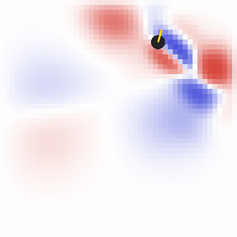
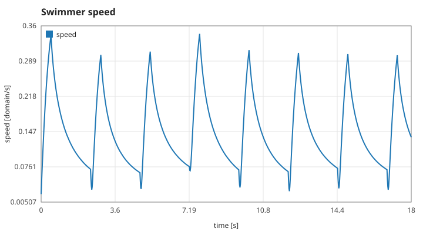
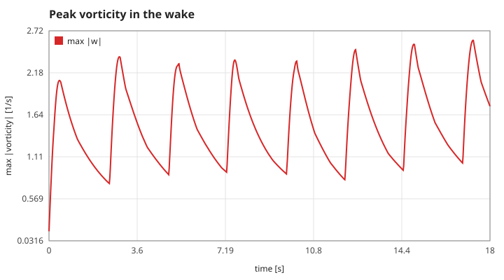
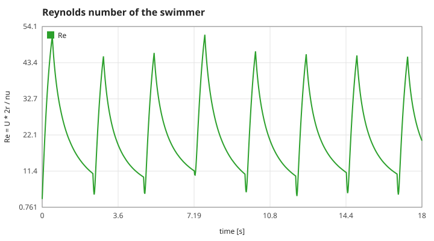
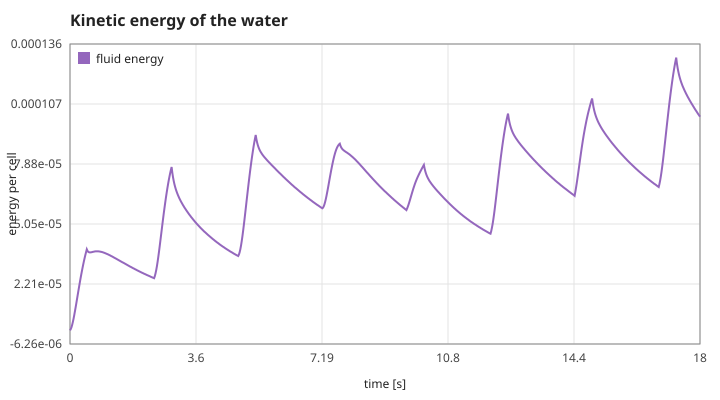

# current-swimmer

Steer a small underwater creature through a 2D incompressible flow, written in plain C11 (only `libm`).
Every stroke of its tail pushes water backwards, and that wake pushes back on you.

<sub>水中の生物を操作する流体力学のおもちゃ。尾を打つたびに水へ運動量を渡し、その渦が自分に返ってきます。</sub>



## What it models

| Piece | Model |
|---|---|
| Water | 2D incompressible Navier-Stokes on a 48 x 48 grid, solved with Stam's *Stable Fluids* (diffusion, semi-Lagrangian advection, pressure projection) |
| Body | A disc with drag (linear + quadratic) against the *relative* velocity of the water, and the cylinder's added mass (inertia = 2 x body mass) |
| Tail | A thrust force along the heading; the equal and opposite force is injected into the water as a Gaussian jet behind the body |
| Walls | Free-slip pool walls |

The Reynolds number `Re = U * 2r / nu` of the default swimmer peaks at about 50, the regime where a pair of counter-rotating vortices (a dipole) forms behind each stroke.

## Plots

Generated by `make plots` from a scripted 18 s swim (CSV in [`docs/run.csv`](docs/run.csv)).

| | |
|---|---|
|  |  |
|  |  |

## Build and play

```bash
make            # needs only a C compiler and make
./current-swimmer
```

| Key | Action |
|---|---|
| `space` / `w` | beat the tail |
| `a` / `d` | turn left / right |
| `p` | pause |
| `q` | quit |

Other modes: `./current-swimmer --headless [dir]` writes the CSV and SVG charts, `--snapshot` prints one frame of the field.

No compiler installed? `docker build -t current-swimmer . && docker run --rm -it current-swimmer`.

## Tests

`make test` checks properties the model has to satisfy:

- still water stays still, and a forced flow ends up divergence-free after projection
- an unforced vortex only loses kinetic energy
- mirrored forcing gives a mirrored flow
- a stroke moves the swimmer along its heading and sends water backwards
- the swimmer cannot leave the pool; the renderer refuses buffers that are too small

## Roadmap

See the open issues: vortex shedding behind obstacles, a tail model that swims by body undulation, and a goal-driven game mode.

## License

MIT
