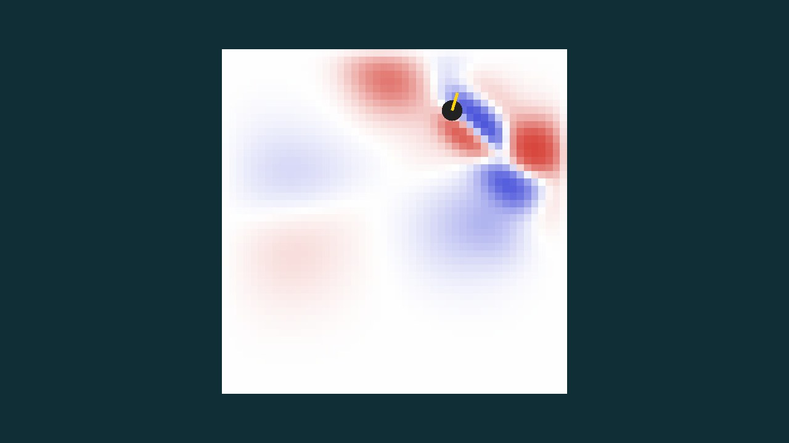
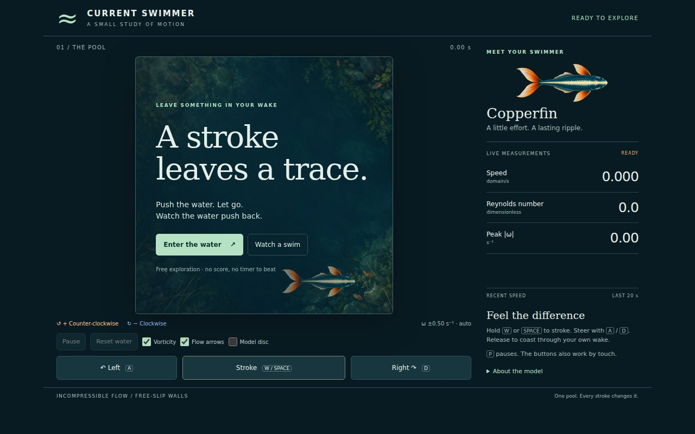
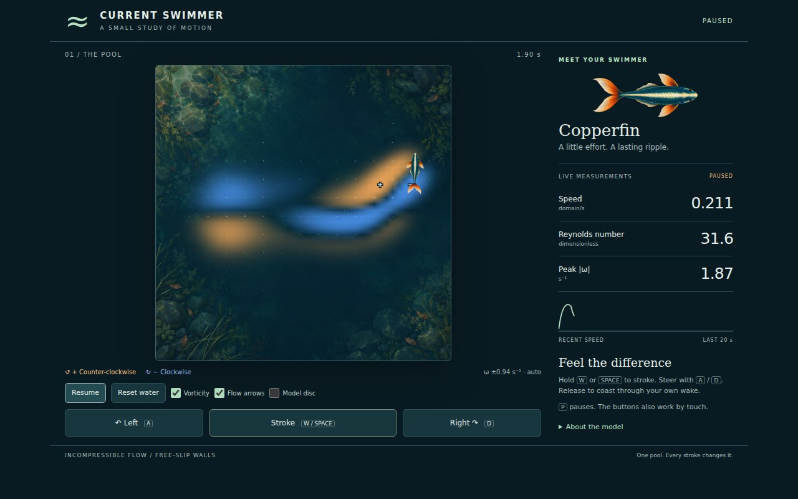
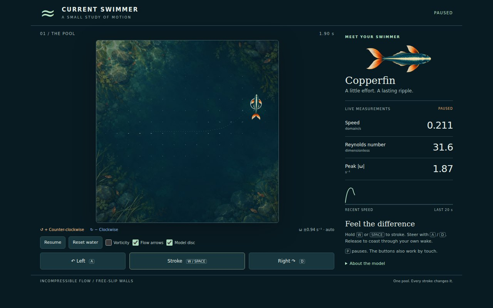
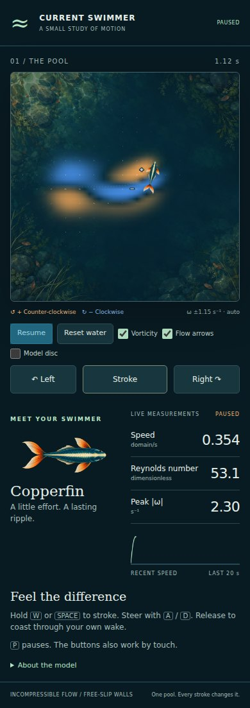
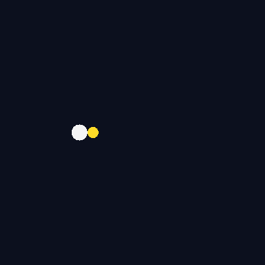

# current-swimmer

Steer a small underwater creature through a 2D incompressible flow, written in plain C11 (only `libm`).
Every stroke of its tail pushes water backwards, and that wake pushes back on you.

<sub>水中の生物を操作する流体力学のおもちゃ。尾を打つたびに水へ運動量を渡し、その渦が自分に返ってきます。</sub>

## M4: 原画で泳ぐブラウザー画面

C11の物理計算を共有するブラウザー画面を追加した。独自生成した魚と水辺の原画2枚を
実際に描画し、渦度の符号・流速の矢印・速度・Reを観察できる。
ストローク中は尾が動き、放すと自分の後流の中を惰性で泳ぐ。
キーボードと同時タッチに対応。画像の出どころ・最終生成指示・採否は
[アート方針](docs/art-direction.md)、検査結果は[検証記録](docs/validation.md)にある。

| 変更前：従来CのSVG出力を撮影 | 変更後：原画を描画するタイトル |
|---|---|
|  |  |

| 渦度と流速を観察 | 絵と計算上の円盤を見比べる |
|---|---|
|  |  |



ブラウザー画面はEmscriptenを用意して次で開く（配信・公開はしない）。

```bash
make play
# http://localhost:4204
```

画面内の Enter the water で開始。Watch a swim は決まった操作の見本、Reset water は
流れと位置を初期化する。Vorticity / Flow arrows / Model disc は表示だけを切り替える。
魚の絵は表現で、物理は直径0.06の円盤のまま。背景の岩・水草も装飾である。
色は相対スケールで、凡例の±値を毎フレーム表示する。
保存機能・外部通信・音声はない。人間の初見試遊と実スマートフォンは未検証。

## 従来の計測表示




## What it models

| Piece | Model |
|---|---|
| Water | 2D incompressible Navier-Stokes on a 48 x 48 grid, solved with Stam's *Stable Fluids* (diffusion, semi-Lagrangian advection, pressure projection) |
| Body | A disc with drag (linear + quadratic) against the *relative* velocity of the water, and the cylinder's added mass (inertia = 2 x body mass) |
| Tail | A thrust force along the heading; the equal and opposite force is injected into the water as a Gaussian jet behind the body |
| Walls | Free-slip pool walls |

The Reynolds number `Re = U * 2r / nu` of the default swimmer peaks at about 50, the regime where a pair of counter-rotating vortices (a dipole) forms behind each stroke.

## Plots

Generated by `make plots` from a scripted 18 s swim (CSV in [`docs/run.csv`](docs/run.csv)).

| | |
|---|---|
|  |  |
|  |  |

## Build and play

```bash
make            # needs only a C compiler and make
./current-swimmer
```

| Key | Action |
|---|---|
| `space` / `w` | beat the tail |
| `a` / `d` | turn left / right |
| `p` | pause |
| `q` | quit |

Other modes: `./current-swimmer --headless [dir]` writes the CSV and SVG charts, `--snapshot` prints one frame of the field, `--gif docs/demo.gif` writes the scripted swim as an animated GIF.

ブラウザー版は `make web` で `dist/` に生成する。Emscriptenの `emcc` をPATHに置くか、
`EMSDK` にインストール先を指定する。Cコンパイラー・Emscriptenともに外部アセットは不要。

## Tests

`make test` checks properties the model has to satisfy:

- still water stays still, and a forced flow ends up divergence-free after projection
- an unforced vortex only loses kinetic energy
- mirrored forcing gives a mirrored flow
- a stroke moves the swimmer along its heading and sends water backwards
- the swimmer cannot leave the pool; the renderer refuses buffers that are too small

追加の検査:

```bash
make bench        # 従来のCSVの全サンプルと照合
make web          # CモデルをWASMへ。配布全体10MB以下を検査
npm ci            # ローカルのブラウザー検査だけに使う依存
npx playwright install chromium
make smoke        # 実キー・同時タッチ・一時停止・リセット・画像欠落、実撮影
```

`make test` はブラウザー接続層と元のCモデルを900ステップ・全2,304セルで
比較する検査も含む。ブラウザー検査はCIで実行せず、既存CIはPR上のC単体検査のみ。

## Roadmap

See the open issues: vortex shedding behind obstacles, a tail model that swims by body undulation, and a goal-driven game mode.

## License

MIT
