# current-swimmer

Steer a small underwater creature through a 2D incompressible flow, written in plain C11 (only `libm`).
Every stroke of its tail pushes water backwards, and that wake pushes back on you.

<sub>水中の生物を操作する流体力学のおもちゃ。尾を打つたびに水へ運動量を渡し、その渦が自分に返ってきます。</sub>

**Theory handbook**: [docs/theory/](docs/theory/README.md) — 26 statements (Navier–Stokes and the Stable Fluids step piece by piece, the walls, numerical diffusion, the pressure projection, the disc's added mass and drag, Newton's third law, the Upstream rules, and the M2 cylinder wake: Reynolds similarity, the staggered-grid step, the penalised obstacle, twin eddies against shedding, the Strouhal number and drag, convergence), each with its equation, assumptions, derivation, code, tests and a figure. `make theory-figs` regenerates the figures and the measured values; `make theory-check` checks the coverage table.

<sub>理論の手引き: 式・前提・導出・実装箇所・検査を、全項目に図つきで説明します。</sub>

## M2: Behind a post — the Kármán vortex street

Water past a fixed cylinder, in a channel 16 D long and 8 D high (`src/wake.c`, a separate solver;
the pool, the swimmer and Upstream are unchanged). The step is the Stable Fluids split on a staggered
grid with MacCormack advection, a pressure solve to $1\times10^{-4}$ U/D and a volume-penalised cylinder;
the force includes the removed momentum and the pressure impulse on the obstacle. Below Re ≈ 47 two eddies stay
attached; above, they leave in turn and the lift swings.

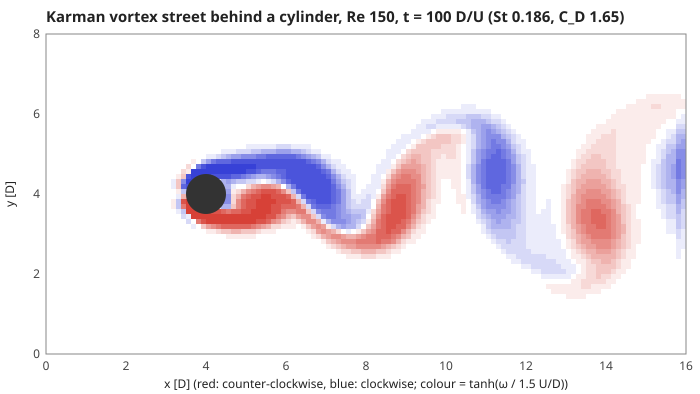

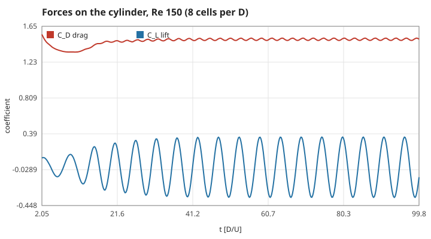

Measured at Re 100–200 on 8 cells per diameter (`make theory-figs`; the CI check runs 6 cells per D):

| Re | St measured | St, Roshko 1954 fit | difference | mean C_D measured | C_D, open water (literature) |
|---|---|---|---|---|---|
| 100 | 0.174 | 0.167 | +4.2 % | 1.543 | about 1.33 |
| 150 | 0.186 | 0.182 | +2.4 % | 1.495 | about 1.33 |
| 200 | 0.194 | 0.190 | +2.2 % | 1.473 | about 1.33 |

Refinement at Re 100: St 0.168 / 0.174 / 0.179 / 0.181 on 6 / 8 / 12 / 16 cells per D; halving the
time step changes St by +1.8 % and C_D by −0.5 %. The original split reads C_D 1.683 instead of 1.543;
in a 32 × 24 D channel it falls to 1.345. The open-water drag value is provisional: the original source
was not accessible. Re 150 and 200 are outside the fit's stated range, 50 < Re < 150
(theory page 5, S26).

```bash
make karman   # docs/karman.svg and docs/karman-forces.svg (about 20 s)
make play     # then open http://localhost:4204/wake.html
```

| Re 150 in the browser (same C code, 6 cells per D) | Re 30: two attached eddies, no swing |
|---|---|
| 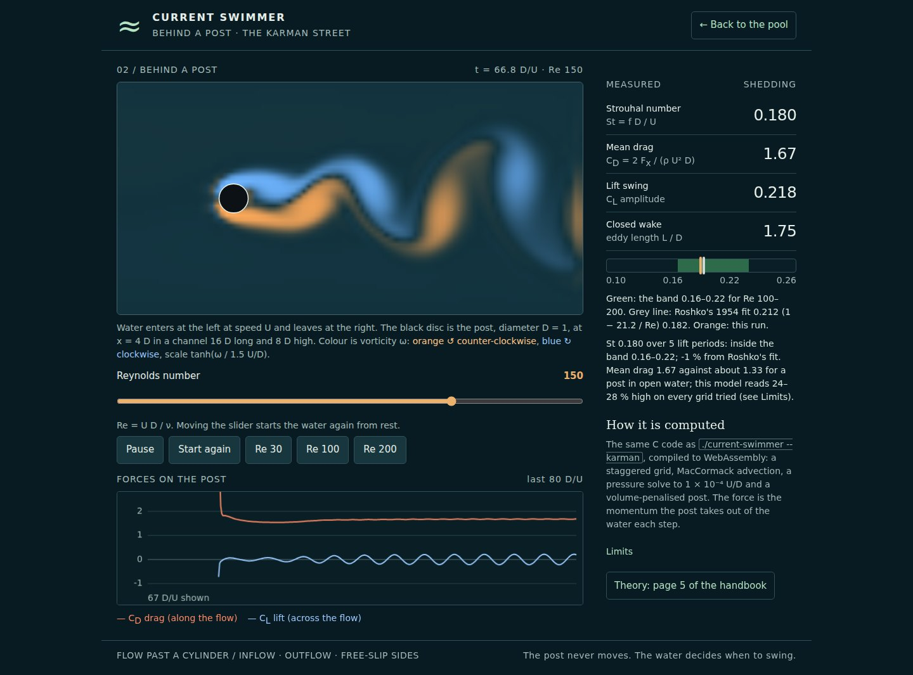 | 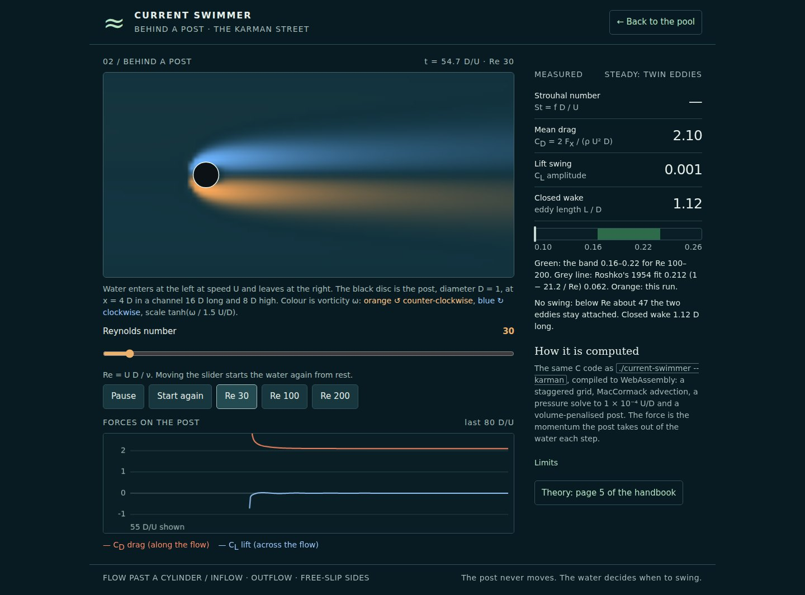 |

<sub>円柱の後ろのカルマン渦列。既定の水路では Re 100・150・200 のストローハル数は 0.16〜0.22。抗力は投影方法と水路寸法に依存し、開水域の文献値は原典未確認(手引き 5 頁)。</sub>

## M5: Upstream, a story in five reaches

A second way to play. The pond is being drained: a sluice at the right wall pushes a jet of
water at you, and Copperfin has to follow Silt, an old loach, up five reaches to a cold spring.
Push to make headway, coast to get your breath back, and coasting in the jet loses ground.
Two choices trade swimming time for breath, and change how the journey ends: the pipe is quick
but squeezes the jet; the ditch is easy water but has a weir where you hold inside a ring for 18 s
while the current runs. Staying with Silt is a 22 s hold in the reeds that gives your breath back,
but the last board comes out as you leave; leaving at once meets a weaker board at the halfway mark.
On a phone, tap the water to swim there, or hold and drag to steer.

| Swimming a reach | Silt stops in the reeds | One of the two endings |
|---|---|---|
| 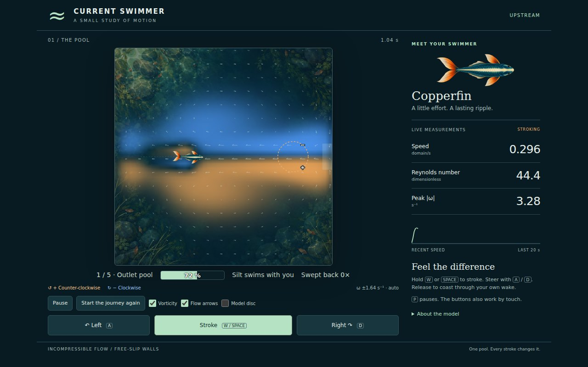 | 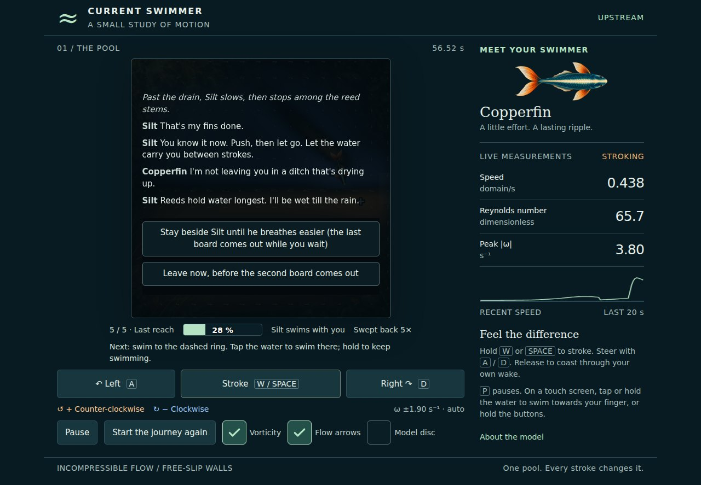 | 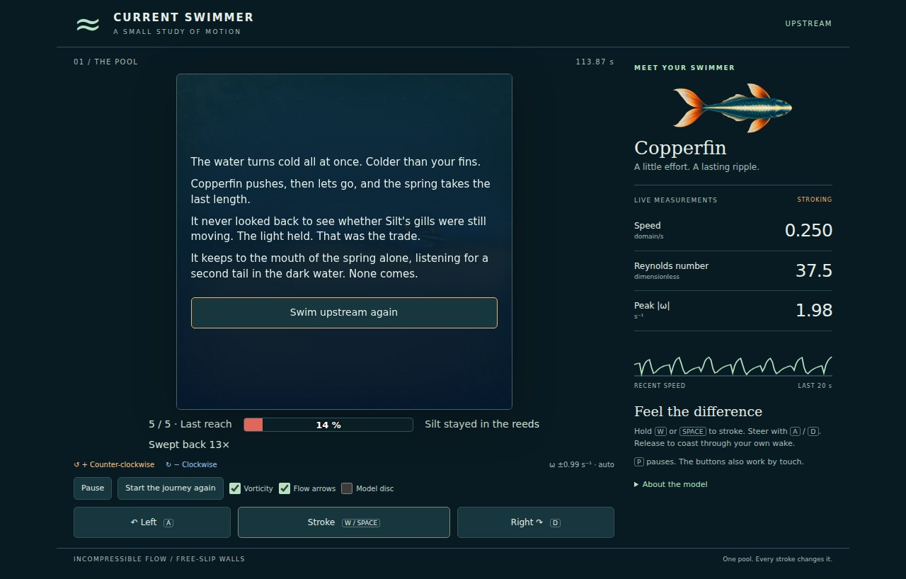 |

The fluid and the disc model are unchanged. The story only changes game numbers: the
strength of the sluice jet and a stamina budget for strokes (`src/journey.c`, one switch per
effect). `make story` plays about 320 journeys with a human-like swimmer and writes the scene
order, an on/off comparison for every story number, and the per-reach crises to
[`docs/narrative/`](docs/narrative/). `make test` re-runs some of those rows and requires them
to match. Results and limits are in the [validation notes](docs/validation.md).

## M4: 原画で泳ぐブラウザー画面

C11の物理計算を共有するブラウザー画面を追加した。独自生成した魚と水辺の原画2枚を
実際に描画し、渦度の符号・流速の矢印・速度・Reを観察できる。
ストローク中は尾が動き、放すと自分の後流の中を惰性で泳ぐ。
キーボードと同時タッチに対応。画像の出どころ・最終生成指示・採否は
[アート方針](docs/art-direction.md)、検査結果は[検証記録](docs/validation.md)にある。

| 変更前：従来CのSVG出力を撮影 | 変更後：原画を描画するタイトル |
|---|---|
| 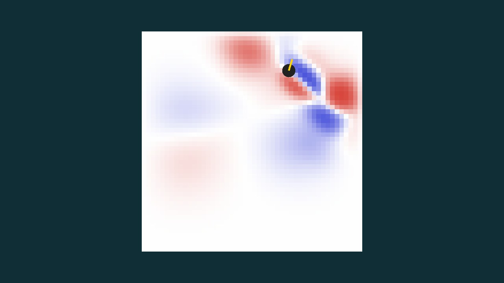 | 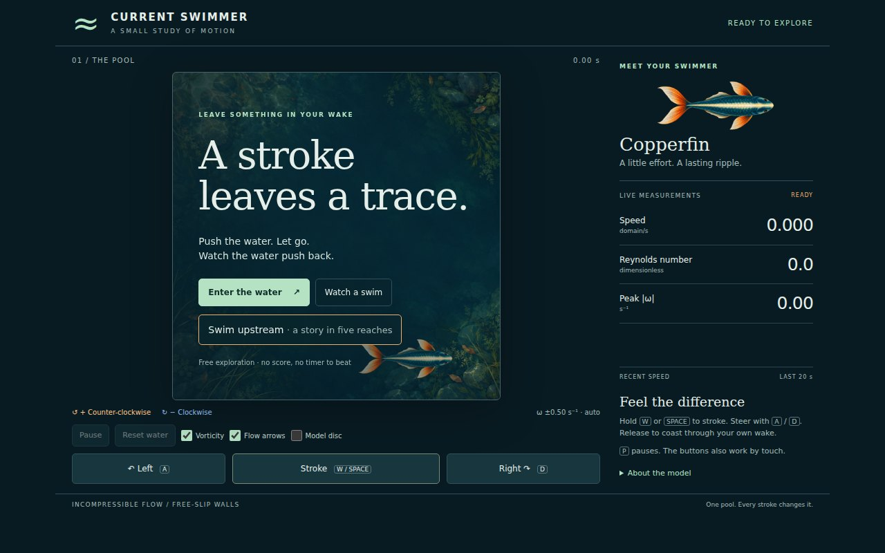 |

| 渦度と流速を観察 | 絵と計算上の円盤を見比べる |
|---|---|
| 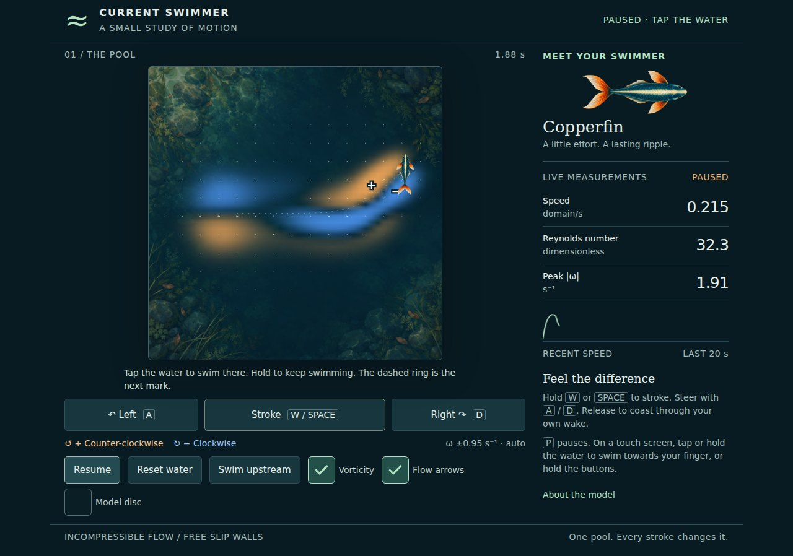 | 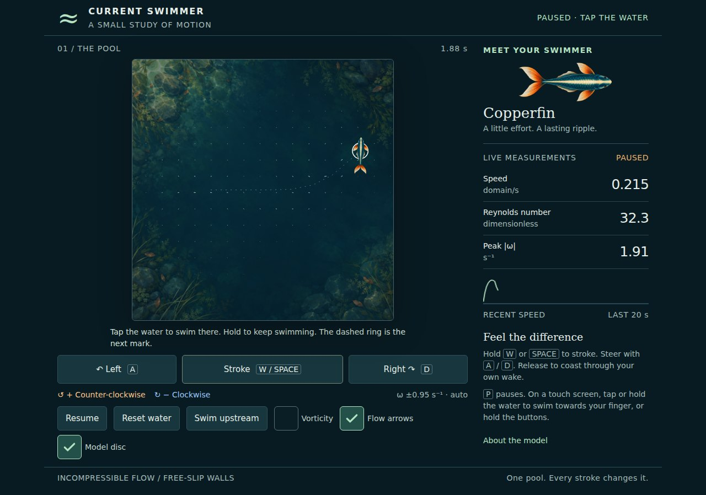 |

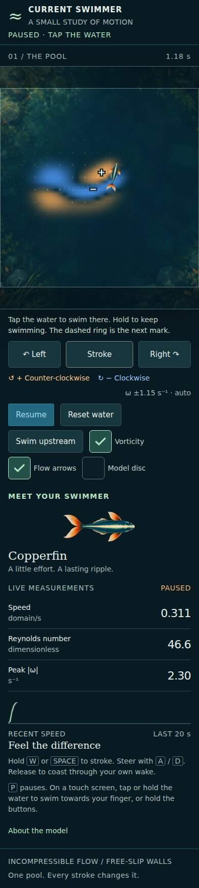

ブラウザー画面はEmscriptenを用意して次で開く（配信・公開はしない）。

```bash
make play
# http://localhost:4204
```

画面内の Enter the water で開始。Watch a swim は決まった操作の見本、Swim upstream は
物語つきの M5、Reset water は流れと位置を初期化する。スマートフォンでは水面をタップするとそこへ泳ぎ、
押したまま動かすと指へ向かう(要件は [docs/requirements.md](docs/requirements.md)、構成は [docs/design.md](docs/design.md))。Vorticity / Flow arrows / Model disc は表示だけを切り替える。
魚の絵は表現で、物理は直径0.06の円盤のまま。背景の岩・水草も装飾である。
色は相対スケールで、凡例の±値を毎フレーム表示する。
保存機能・外部通信・音声はない。人間の初見試遊と実スマートフォンは未検証。

## 従来の計測表示

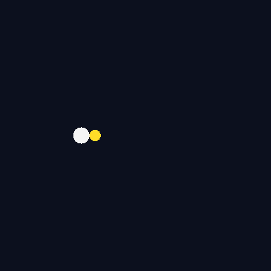

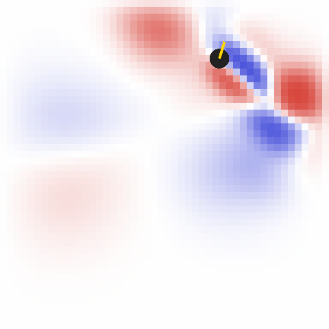

## What it models

| Piece | Model |
|---|---|
| Water | 2D incompressible Navier-Stokes on a 48 x 48 grid, solved with Stam's *Stable Fluids* (diffusion, semi-Lagrangian advection, pressure projection) |
| Body | A disc with drag (linear + quadratic) against the *relative* velocity of the water, and the cylinder's added mass (inertia = 2 x body mass) |
| Tail | A thrust force along the heading; the equal and opposite force is injected into the water as a Gaussian jet behind the body |
| Walls | Free-slip pool walls |

The Reynolds number `Re = U * 2r / nu` of the default swimmer peaks at about 50, the regime where a pair of counter-rotating vortices (a dipole) forms behind each stroke.

## Plots

Generated by `make plots` from a scripted 18 s swim (CSV in [`docs/run.csv`](docs/run.csv)).

| | |
|---|---|
| 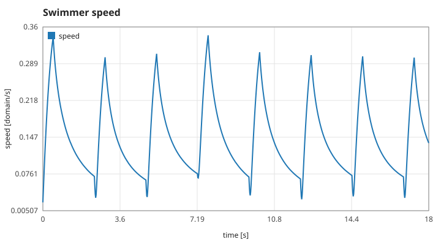 | 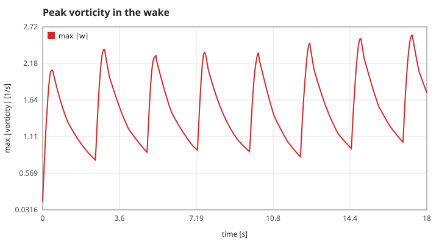 |
| 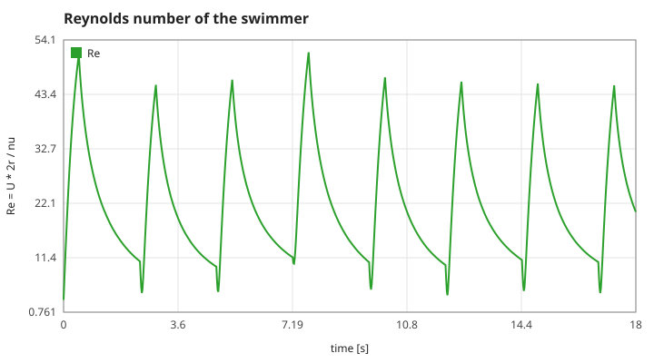 | 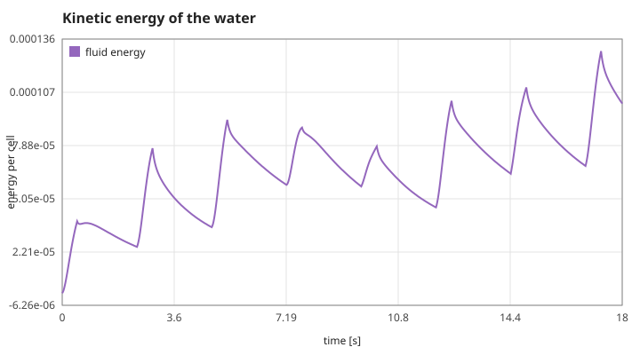 |

## Build and play

```bash
make            # needs only a C compiler and make
./current-swimmer
```

| Key | Action |
|---|---|
| `space` / `w` | beat the tail |
| `a` / `d` | turn left / right |
| `p` | pause |
| `q` | quit |

Other modes: `./current-swimmer --headless [dir]` writes the CSV and SVG charts, `--snapshot` prints one frame of the field, `--gif docs/demo.gif` writes the scripted swim as an animated GIF.

ブラウザー版は `make web` で `dist/` に生成する。Emscriptenの `emcc` をPATHに置くか、
`EMSDK` にインストール先を指定する。Cコンパイラー・Emscriptenともに外部アセットは不要。

## Tests

`make test` checks properties the model has to satisfy:

- still water stays still, and a forced flow ends up divergence-free after projection
- an unforced vortex only loses kinetic energy
- mirrored forcing gives a mirrored flow
- a stroke moves the swimmer along its heading and sends water backwards
- the swimmer cannot leave the pool; the renderer refuses buffers that are too small

追加の検査:

```bash
make bench        # 従来のCSVの全サンプルと照合
make web          # CモデルをWASMへ。配布全体10MB以下を検査
npm ci            # ローカルのブラウザー検査だけに使う依存
npx playwright install chromium
make smoke        # 実キー・同時タッチ・一時停止・リセット・画像欠落、実撮影
```

`make test` はブラウザー接続層と元のCモデルを900ステップ・全2,304セルで
比較する検査も含む。ブラウザー検査はCIで実行せず、既存CIはPR上のC単体検査のみ。

## Roadmap

See the open issues: vortex shedding behind obstacles, a tail model that swims by body undulation, and a goal-driven game mode.

## License

MIT
