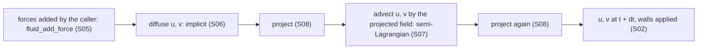
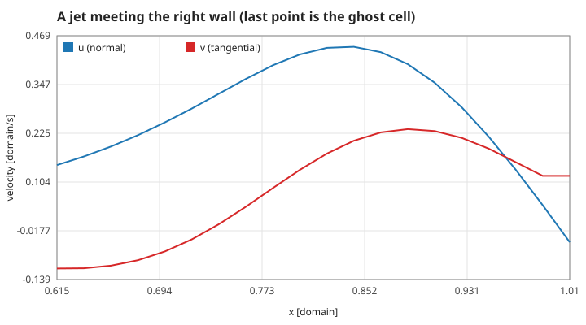
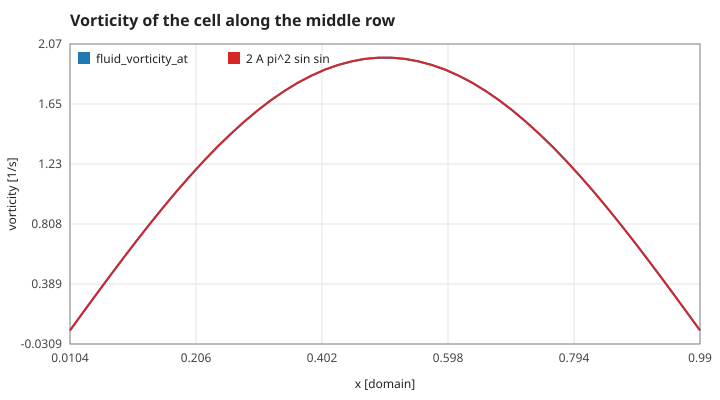
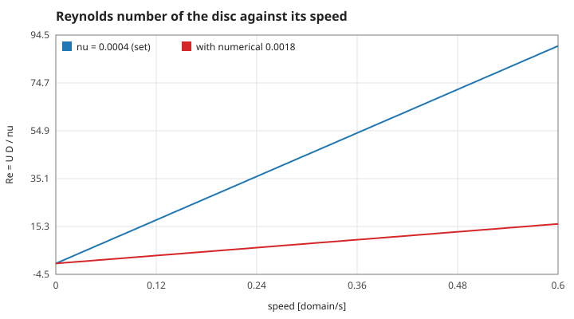

# 1. The water: equations, grid, walls and what is measured

Units throughout: the pond is the unit square, so lengths are in domain widths; time is in seconds; the density of water is 1, so a force is also an acceleration of unit area of water. Measured numbers are quoted by their id in [figures/values.md](figures/values.md).

[Back to the index](README.md)

## S01 — Incompressible Navier–Stokes, solved one piece at a time

**Statement.** The velocity $\mathbf u = (u, v)$ of the water obeys

$$\frac{\partial \mathbf u}{\partial t} = -(\mathbf u\cdot\nabla)\mathbf u - \nabla p + \nu\nabla^2\mathbf u + \mathbf f, \qquad \nabla\cdot\mathbf u = 0,$$

with kinematic viscosity $\nu$ (0.0004 in the game), pressure $p$ (per unit density) and body force $\mathbf f$ [Batchelor 1967, §3.2; Landau & Lifshitz 1987, §15]. The solver follows Stam's "Stable Fluids": each term is advanced on its own, in a fixed order, and each sub-step is stable for any time step [Stam 1999; Stam 2003].

**Assumptions and where they break.** Two dimensions, constant density and viscosity, no free surface. Splitting the terms is first-order accurate in time: the result depends on $\Delta t$ (0.02 s everywhere in the program) and on the order of the pieces. The solver is built to stay stable and look right, not to converge fast (S07, S08).

**Derivation.** Momentum conservation for a fluid parcel gives the first equation; mass conservation at constant density gives the second. The splitting treats $\partial_t\mathbf u = A\mathbf u + B\mathbf u + \dots$ by solving $\partial_t\mathbf u = A\mathbf u$, then $\partial_t\mathbf u = B\mathbf u$ from that result, and so on (Lie splitting); the pressure is not advanced but chosen so that the result is divergence-free (S08).

**Code.** `fluid_step` in `src/fluid.c`: `diffuse` twice, `project`, `advect` twice, `project`. `fluid_init` allocates the six arrays (velocity, scratch copies, pressure, divergence); `fluid_free` releases them. Forces are added before the step by the caller.

**Tests.** `test_still_water_stays_still` in `tests/test_fluid.c`: with no force the energy stays exactly 0. `test_symmetry_of_mirrored_forcing`: mirrored forces give mirrored flows to 0.01. The pieces are measured one by one in page 2.

## S02 — The grid, the ghost cells and the walls

**Statement.** Velocities live at the centres of an $n \times n$ grid of cells of size $h = 1/n$ ($n = 48$ in the game); cell $(i, j)$, $1 \le i, j \le n$, is centred at $((i - \tfrac12)h, (j - \tfrac12)h)$. A ring of ghost cells (index 0 and $n + 1$) carries the boundary condition of a **free-slip wall**:

$$\mathbf u\cdot\mathbf n = 0 \quad\text{(no flow through the wall)}, \qquad \frac{\partial (\mathbf u\cdot\mathbf t)}{\partial n} = 0 \quad\text{(no shear on the wall)} .$$

In ghost cells the wall-normal component is the first interior value with its sign flipped, so their average — the value on the wall — is 0; the tangential component, the pressure and the divergence are copied.

**Assumptions and where they break.** A free-slip wall does not hold the water: there is no boundary layer and no vorticity is made at the walls. Real pond walls are no-slip. The corners take the average of their two neighbours.

**Derivation.** With cell centres half a cell from the wall, linear interpolation to the wall is $\tfrac12(\text{ghost} + \text{first})$; setting it to 0 gives ghost $= -$first. A zero normal derivative across the wall is ghost $=$ first.

**Code.** `set_bnd` in `src/fluid.c` (static): `b == 1` flips the sign on the left and right walls (for $u$), `b == 2` on the bottom and top (for $v$), `b == 0` copies (pressure, divergence). It is called after every sweep of the linear solver, after advection and after projection.

**Tests.** `test_swimmer_stays_inside_the_pool` covers the body's walls (S14); the water's walls are measured here: after 3 s of a jet aimed at a wall, ghost plus first cell is exactly 0 on both side walls (`wall-normal`), the tangential ghost equals its neighbour exactly (`wall-tangent`), the flux through the wall is 0 (`wall-flux`), and the water slides along the wall at `wall-slip` = 0.48 domain/s.

## S03 — Energy, vorticity and circulation: the three diagnostics

**Statement.** The program reports, from the grid,

$$E = \frac{1}{n^2}\sum_{i,j}\tfrac12\left(u_{ij}^2 + v_{ij}^2\right), \qquad \omega_{ij} = \frac{v_{i+1,j} - v_{i-1,j}}{2h} - \frac{u_{i,j+1} - u_{i,j-1}}{2h}, \qquad \Gamma = \frac{1}{n^2}\sum_{i,j}\omega_{ij} .$$

$E$ approximates the kinetic energy $\int \tfrac12|\mathbf u|^2\,dA$ of the unit square, $\omega$ the vorticity $\partial_x v - \partial_y u$, and $\Gamma$ its integral, which by Stokes' theorem is the circulation $\oint \mathbf u\cdot d\mathbf l$ round the walls [Batchelor 1967, §2.6]. The discrete divergence uses the same central differences.

**Assumptions and where they break.** Central differences are second-order accurate in $h$ and blind to the cell-to-cell (checkerboard) mode. $\Gamma$ is not conserved here: with free-slip walls the water can circulate round the pond, and it does once a swimmer has turned.

**Derivation.** Midpoint quadrature for the integrals; Taylor expansion gives the error $\tfrac16 h^2 \partial^3$ of a central difference. The test field is the cell $\psi = A\sin\pi x\,\sin\pi y$ ($u = \partial_y\psi$, $v = -\partial_x\psi$), for which $E = A^2\pi^2/4$, $\omega = 2A\pi^2\sin\pi x\,\sin\pi y$ and $\Gamma = 8A$ in closed form.

**Code.** `fluid_kinetic_energy`, `fluid_vorticity_at`, `fluid_max_abs_vorticity`, `fluid_total_circulation`, `fluid_max_divergence` in `src/fluid.c`. The browser colours each cell by `fluid_vorticity_at` (S15).

**Tests.** `test_unforced_flow_only_loses_energy` uses the energy (S09). Measured on the cell $A = 0.1$: `energy-cell` matches $A^2\pi^2/4$ to 8 digits, `vorticity-centre` to 7 parts in 10 000 (the $h^2$ error), `vorticity-max`, `circulation-cell` = 0.7997 against 0.8, and `divergence-cell` = 7e-7.

## S04 — The Reynolds number

**Statement.** For a body of size $L$ moving at speed $U$ through water of viscosity $\nu$,

$$Re = \frac{U L}{\nu}$$

is the ratio of inertial to viscous effects [Reynolds 1883; Batchelor 1967, §4.7]. The display uses the disc's diameter $L = 0.06$: at $U = 0.5$, $Re = 75$.

**Assumptions and where they break.** $Re$ describes the equations, not this solver: the semi-Lagrangian step adds a numerical viscosity several times larger than the 0.0004 that is set (S07), so the flow on screen behaves like a lower Reynolds number than the one displayed. The red line in the figure uses the value measured in S07 for a flow of speed 0.3.

**Derivation.** Scale the equation of S01 with $L$, $U$ and $L/U$: the viscous term carries the factor $\nu/(UL) = 1/Re$.

**Code.** `reynolds_number` in `src/fluid.c`; it returns infinity for $\nu = 0$. `src/view.c` and `src/main.c` call it with the diameter.

**Tests.** `test_reynolds_number`: 75 within 0.001 for the default, infinite for zero viscosity. Measured: `reynolds-default`, and `reynolds-top` = 68.8 at the fastest the disc swims in still water (S12).

## References

- G. K. Batchelor, *An Introduction to Fluid Dynamics*, Cambridge University Press, 1967.
- L. D. Landau, E. M. Lifshitz, *Fluid Mechanics*, 2nd ed., Pergamon, 1987.
- J. Stam, "Stable Fluids", *Proc. SIGGRAPH 99*, 121–128, 1999.
- J. Stam, "Real-Time Fluid Dynamics for Games", *Proc. Game Developers Conference*, 2003.
- O. Reynolds, "An experimental investigation of the circumstances which determine whether the motion of water shall be direct or sinuous", *Phil. Trans. R. Soc.* 174, 935–982, 1883.
