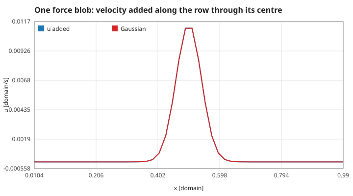
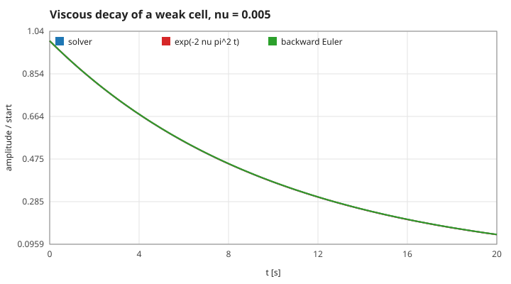
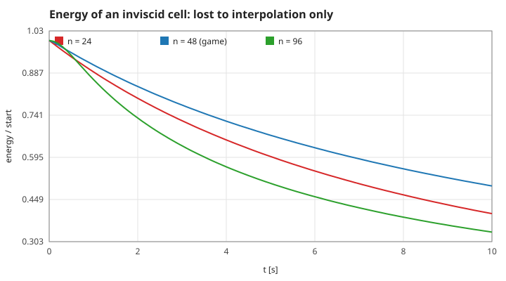
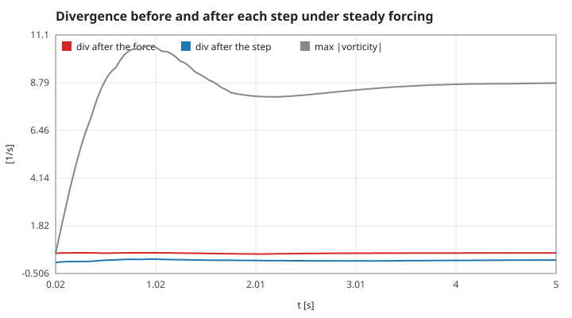
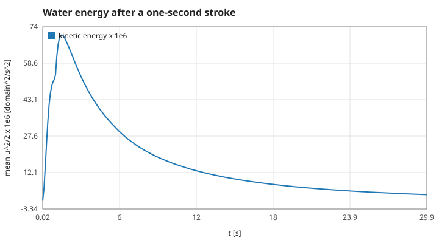
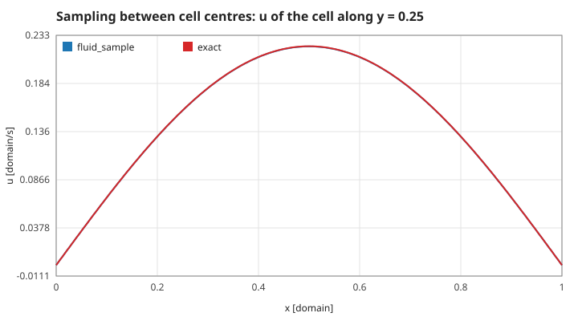

# 2. The Stable Fluids step, piece by piece

Each sub-step of `fluid_step` (S01), with what it guarantees and what it costs. Units as in page 1. Measured numbers are quoted by their id in [figures/values.md](figures/values.md).

[Back to the index](README.md)

## S05 — Adding a force: a Gaussian blob

**Statement.** A force is applied to the water as a velocity increment with a Gaussian footprint of width $\sigma$ centred at $\mathbf x_0$:

$$\Delta\mathbf u(\mathbf x) = \mathbf g\,\Delta t\,\exp\left(-\frac{|\mathbf x - \mathbf x_0|^2}{2\sigma^2}\right).$$

Since $\int \exp(-r^2/2\sigma^2)\,dA = 2\pi\sigma^2$, a total force $\mathbf F$ (momentum per second, density 1) is delivered by $\mathbf g = \mathbf F / (2\pi\sigma^2)$.

**Assumptions and where they break.** The blob must lie inside the square for the whole force to arrive: a blob centred closer than about $3\sigma$ to a wall loses its tail (the sluice of S16 sits 0.04 from the wall with $\sigma = 0.07$ and is specified by its strength $\mathbf g$, not by a total force). The increment is not divergence-free; the next projection takes care of that (S08).

**Derivation.** Explicit Euler for $\partial_t\mathbf u = \mathbf f$ with $\mathbf f = \mathbf g\,e^{-r^2/2\sigma^2}$; the normalisation is the Gaussian integral.

**Code.** `fluid_add_force` in `src/fluid.c` takes $\mathbf g$; the static helper `push_fluid` in `src/swimmer.c` divides a force by $2\pi\sigma^2$ first.

**Tests.** `test_stroke_pushes_swimmer_forward_and_water_backward` in `tests/test_fluid.c` checks the sign of the jet. Measured: one blob of force 0.006 for 0.02 s adds a grid momentum of `force-impulse` = 0.00012 = $F\Delta t$ to 1 part in 10 million; `force-peak`.

## S06 — Diffusion: an implicit step that cannot blow up

**Statement.** Viscosity is advanced by backward Euler on the five-point Laplacian,

$$\left(1 + 4a\right)u_{ij}^{new} - a\left(u_{i-1,j}^{new} + u_{i+1,j}^{new} + u_{i,j-1}^{new} + u_{i,j+1}^{new}\right) = u_{ij}^{old}, \qquad a = \nu\,\Delta t\,n^2,$$

solved approximately by 24 Gauss–Seidel sweeps. A Fourier mode with discrete eigenvalue $\lambda_h$ is multiplied by $1/(1 + \nu\Delta t\lambda_h) \le 1$ per step, for any $\Delta t$ [Stam 1999, §3.2].

**Assumptions and where they break.** Backward Euler is first-order in time. Twenty-four sweeps do not solve the system exactly; at the game's $a = 0.018$ the matrix is so close to the identity that they converge to rounding, but for a large $a$ (large $\nu\Delta t$) long waves are under-damped. An explicit step would need $\Delta t \le h^2/(4\nu)$.

**Derivation.** Put $u^{new} = \hat u\,e^{i(kx + ly)}$ into the scheme: $\hat u^{new}(1 + \nu\Delta t\lambda_h) = \hat u^{old}$ with $\lambda_h = (4 - 2\cos kh - 2\cos lh)/h^2 \ge 0$. The exact solution decays as $e^{-\nu(k^2 + l^2)t}$; for the test cell of S03 that is $e^{-2\nu\pi^2 t}$.

**Code.** `diffuse` and `lin_solve` in `src/fluid.c` (static); `lin_solve` is shared with the pressure solve (S08).

**Tests.** `test_unforced_flow_only_loses_energy`. Measured with $\nu = 0.005$: after 10 s the amplitude is `diffusion-decay` = 0.3725 against $e^{-2\nu\pi^2 t}$ = 0.3727, and within 0.2 % of the discrete factor (`diffusion-discrete`). With steps 500 times the explicit limit the energy still only falls (`diffusion-big-step`).

## S07 — Advection: follow the water backwards, and what that costs

**Statement.** The transport term $-(\mathbf u\cdot\nabla)\mathbf u$ is advanced semi-Lagrangially: the new value at a cell centre is the old field at the point the water came from,

$$\mathbf u^{new}(\mathbf x) = \mathbf u^{old}\big(\mathbf x - \Delta t\,\mathbf u^{old}(\mathbf x)\big),$$

evaluated by bilinear interpolation between the four surrounding centres. Every new value is a weighted mean of old values with weights in $[0, 1]$, so no new extremum can appear: **stable for any time step** [Stam 1999, §3.2; Courant, Isaacson & Rees 1952].

**Assumptions and where they break.** The backward path is one straight Euler step, and the departure point is clamped to the grid. The interpolation smooths: the scheme behaves as if a viscosity of order $|\mathbf u|h$ were added [Fedkiw, Stam & Jensen 2001, §1]. On the game's grid that numerical viscosity is larger than the physical one, so small eddies fade sooner than the equations say and the effective Reynolds number is lower than displayed (S04).

**Derivation.** $D\mathbf u/Dt = 0$ says $\mathbf u$ is constant along particle paths; tracing the path back one step and reading the old field there is exact for a uniform flow. Bilinear weights are $s_0 t_0, s_0 t_1, s_1 t_0, s_1 t_1$ with $s_0 + s_1 = t_0 + t_1 = 1$: a convex combination, hence the maximum principle.

**Code.** `advect` in `src/fluid.c` (static), called for $u$ and $v$ with the projected field of the same step as the carrier.

**Tests.** `test_unforced_flow_only_loses_energy`: the energy of a vortex never rises by more than 0.1 % in a step. Measured with $\nu = 0$ on a cell of speed 0.31: the game's grid loses `advection-loss-48` = 50 % of the energy in 10 s, which a viscosity of `advection-nu-48` = 0.0018 would cause — 4.4 times the 0.0004 that is set. The largest vorticity never grows (`advection-max-principle`), no step gains energy (`advection-no-growth`), and a step of 1 s — the water crossing 15 cells — stays bounded (`advection-big-step`). The loss is not smallest on the finest grid (`advection-loss-24` 60 %, `advection-loss-96` 66 %): there the 24 pressure sweeps no longer keep up, see S08.

## S08 — Projection: making the flow incompressible again

**Statement.** Any velocity field $\mathbf w$ in the box splits uniquely into a divergence-free part that respects the walls and a gradient (Helmholtz–Hodge): $\mathbf w = \mathbf u + \nabla p$. The step solves

$$\nabla^2 p = \nabla\cdot\mathbf w, \qquad \frac{\partial p}{\partial n} = 0 \text{ on the walls}, \qquad \mathbf u = \mathbf w - \nabla p$$

with central differences and 24 Gauss–Seidel sweeps for $p$ [Chorin 1968; Stam 1999, §3.2].

**Assumptions and where they break.** The sweeps are a fixed budget, not a converged solve. Gauss–Seidel removes short-wave divergence quickly and box-sized modes slowly, and the number of sweeps needed grows like $n^2$. Two consequences are measured below: some divergence is always left, and a net push on the water — which an exact projection in a closed box would cancel at once — takes about a second to drain away. The central-difference divergence also cannot see a checkerboard pressure.

**Derivation.** Take the divergence of $\mathbf w = \mathbf u + \nabla p$ and require $\nabla\cdot\mathbf u = 0$. In a closed box $\int \mathbf u\,dA = \oint \mathbf x\,(\mathbf u\cdot\mathbf n)\,dl - \int \mathbf x\,(\nabla\cdot\mathbf u)\,dA = 0$: incompressible water between solid walls has no net momentum; the walls take it up through the pressure.

**Code.** `project` in `src/fluid.c` (static): the right-hand side is $-\tfrac12 h(\Delta_x u + \Delta_y v)$, `lin_solve` with $a = 1$, $c = 4$, then the gradient is subtracted and the walls reapplied. It runs twice per step (S01).

**Tests.** `test_projection_keeps_flow_divergence_free`: the divergence after a step is below a tenth of the divergence put in. Measured: `projection-before` = 0.468 becomes `projection-after` = 0.022 (`projection-ratio` = 0.047); under steady forcing the leftover divergence stays below 5 % of the largest vorticity (`projection-vs-vorticity`). On other grids, after 10 s of the inviscid cell: `residual-24` = 1.3 %, `residual-48` = 8.9 %, `residual-96` = 43 %. Net momentum from one blob: `box-momentum-1` = 99.8 % is still there after one step, `box-momentum-100` = 0.007 % after 2 s.

## S09 — Without forcing, the energy only falls

**Statement.** For the exact equations in a box with free-slip walls,

$$\frac{dE}{dt} = -\nu\int\omega^2\,dA + \int\mathbf f\cdot\mathbf u\,dA :$$

with no force the kinetic energy can only decrease [Batchelor 1967, §3.4]. The discrete step keeps the inequality: diffusion damps every mode (S06), advection averages (S07), and projection removes a part that is orthogonal to what it keeps (S08).

**Assumptions and where they break.** The discrete projection is orthogonal only when solved exactly; with 24 sweeps the unit test allows a rise of 0.1 % per step and none was observed. The decay is faster than $\nu$ alone explains, by the numerical viscosity of S07.

**Derivation.** Dot the momentum equation with $\mathbf u$ and integrate: the transport and pressure terms become boundary fluxes that vanish with $\mathbf u\cdot\mathbf n = 0$, and $\int\mathbf u\cdot\nabla^2\mathbf u = -\int\omega^2$ for a divergence-free field with these walls.

**Code.** `fluid_kinetic_energy` in `src/fluid.c`; the property belongs to `fluid_step` as a whole.

**Tests.** `test_unforced_flow_only_loses_energy` (50 steps, tolerance 0.1 % per step); `test_still_water_stays_still`. Measured: 30 s after a one-second stroke the water holds `energy-after-stroke` = 3.9 % of its peak energy, and from 8 s on no step gains any (`energy-no-growth` = 0).

## S10 — Reading the velocity between cell centres

**Statement.** The velocity at an arbitrary point is the bilinear interpolation of the four nearest cell centres — the same stencil as S07 — with the point clamped to the square. It is exact for any field linear in $x$ and $y$ and second-order accurate otherwise.

**Assumptions and where they break.** Within half a cell of a wall the stencil uses ghost values, so the normal component goes linearly to 0 on the wall (S02). Outside the square the result is the clamped edge value, never garbage.

**Derivation.** A bilinear function is determined by its four corner values; a linear field is bilinear. The error for a smooth field is bounded by $\tfrac18 h^2$ times its second derivatives.

**Code.** `fluid_sample` in `src/fluid.c`. The swimmer reads the water at its centre with it (S12); the browser reads the field cell by cell through `view_field` instead.

**Tests.** `test_stroke_pushes_swimmer_forward_and_water_backward` samples the jet behind the body. Measured: error on a linear field `sample-linear` = 1e-7 (rounding), on the sine cell `sample-sine` = 2.4e-4 of an amplitude 0.22, and a point far outside is finite (`sample-clamped`).

## References

- J. Stam, "Stable Fluids", *Proc. SIGGRAPH 99*, 121–128, 1999.
- A. J. Chorin, "Numerical solution of the Navier–Stokes equations", *Math. Comp.* 22, 745–762, 1968.
- R. Courant, E. Isaacson, M. Rees, "On the solution of nonlinear hyperbolic differential equations by finite differences", *Comm. Pure Appl. Math.* 5, 243–255, 1952.
- R. Fedkiw, J. Stam, H. W. Jensen, "Visual simulation of smoke", *Proc. SIGGRAPH 2001*, 15–22.
- G. K. Batchelor, *An Introduction to Fluid Dynamics*, Cambridge University Press, 1967.
