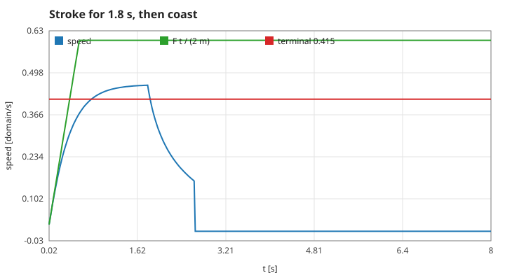
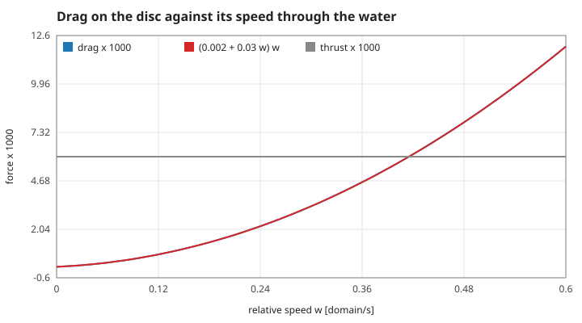
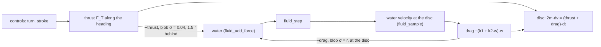
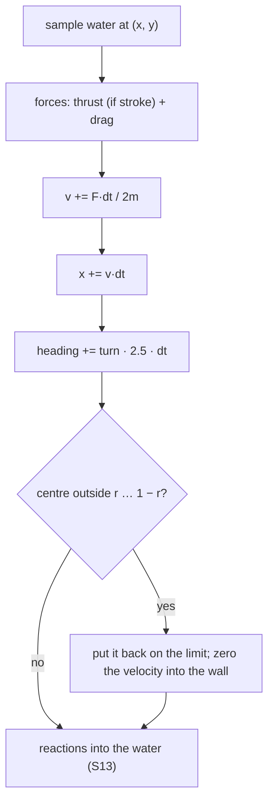
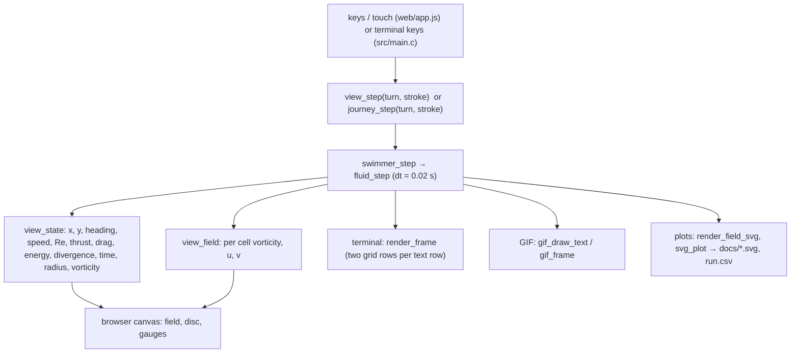

# 3. The swimmer: a disc in the water, and the path to the screen

The body is a rigid disc, not a fish: it has a position, a velocity, a heading and a radius of 0.03 (diameter 0.06), and it exchanges forces with the water. The artwork drawn over it is decoration. Measured numbers are quoted by their id in [figures/values.md](figures/values.md).

[Back to the index](README.md)

## S11 — A neutrally buoyant disc and its added mass

**Statement.** The disc has the density of water, so its mass is $m = \pi r^2$ (density 1, unit depth). To accelerate it, the water around it must be accelerated too; for a circular cylinder in an ideal fluid that added mass equals the displaced mass [Lamb 1932, §68; Batchelor 1967, §6.4]. The equation of motion is therefore

$$(m + m_{added})\,\dot{\mathbf v} = 2m\,\dot{\mathbf v} = \mathbf F_{thrust} + \mathbf F_{drag} .$$

**Assumptions and where they break.** The factor 2 is the potential-flow result for an isolated cylinder far from walls, accelerating relative to water at rest. Here it is a fixed coefficient; near a wall or in a strongly sheared jet the true added mass differs.

**Derivation.** The kinetic energy of the potential flow round a cylinder moving at speed $V$ is $\tfrac12\rho\pi r^2 V^2$ — the same as the cylinder's own — so the work needed to change $V$ is doubled.

**Code.** `swimmer_init` (sets `mass = PI_F * radius * radius`) and the line `meff = 2.0f * s->mass` in `swimmer_step`, `src/swimmer.c`. `swimmer_speed` is $|\mathbf v|$.

**Tests.** `test_stroke_pushes_swimmer_forward_and_water_backward` in `tests/test_fluid.c`. Measured: `mass-disc` = 0.0028274 = $\pi r^2$; after the first 0.02 s stroke from rest the speed is `first-step-speed` = 0.021221 = $F\Delta t/(2m)$ to 8 digits.

## S12 — Thrust, drag and the terminal speed

**Statement.** While the tail beats, a constant thrust $F_T = 0.006$ acts along the heading. Drag acts against the velocity **relative to the local water**, $\mathbf w = \mathbf v - \mathbf u(\mathbf x_{disc})$, with a linear and a quadratic part:

$$\mathbf F_{drag} = -(k_1 + k_2|\mathbf w|)\,\mathbf w, \qquad k_1 = 0.002, \quad k_2 = \tfrac12 C_D\,\rho\,D = 0.03 \ (C_D = 1,\ D = 0.06).$$

In steady swimming thrust balances drag: $k_2 w^2 + k_1 w = F_T$, so $w_\infty = 0.4151$.

**Assumptions and where they break.** A drag coefficient of 1 is the order of magnitude for a cylinder at Reynolds numbers from about a hundred to a hundred thousand [Batchelor 1967, §4.12]; the linear term stands in for viscous drag at low speed. The force is a formula, not an integral of pressure and shear over the disc: the water does not flow round the body, it only feels the reaction (S13). The water velocity is read at the disc's centre only.

**Derivation.** The quadratic form is the dynamic pressure $\tfrac12\rho w^2$ times the frontal width $D$ times $C_D$; the terminal speed is the positive root of the balance.

**Code.** `swimmer_step` in `src/swimmer.c`: `fluid_sample` at the disc, `k = DRAG_LIN + DRAG_QUAD * w`, thrust `STROKE_THRUST` along `(cos heading, sin heading)`; the last thrust and drag are kept in the struct for display.

**Tests.** `test_stroke_pushes_swimmer_forward_and_water_backward`: the disc moves along its heading and does not drift sideways by more than 0.001. Measured: `drag-at-0.5` = 0.0085 exactly as the formula; at its fastest in still water the disc moves through the local water at `terminal-relative` = 0.4137 (theory 0.4151, not quite settled after 1.8 s) while its speed over the ground is `terminal-speed` = 0.459 — it carries water along with it — and the model reports a drag of `drag-at-top` = 0.00596 against the thrust 0.006.

## S13 — Newton's third law: what the disc does to the water

**Statement.** Every force on the disc is returned to the water with the opposite sign in the same step:

- the **thrust reaction** $-\mathbf F_T$ as a blob of width 0.04 centred 1.5 radii behind the disc (the tail jet);
- the **drag reaction** $-\mathbf F_{drag}$ as a blob of width $r$ at the disc (the water it drags along).

The momentum given to the water in a step is exactly minus the momentum $2m\,\Delta\mathbf v$ gained by the disc.

**Assumptions and where they break.** This is the only coupling: the disc is not an obstacle to the flow, so there is no bow wave and no separated wake of a solid body — the wake on screen is the jet and the dragged water. The balance holds at the moment of injection; the closed box then removes the water's net momentum through the walls (S08), which the disc's momentum does not follow. Blobs within $3\sigma$ of a wall are clipped (S05).

**Derivation.** Action and reaction; each blob is normalised to carry the whole force (S05).

**Code.** The last two calls of `swimmer_step` in `src/swimmer.c` (`push_fluid`).

**Tests.** `test_stroke_pushes_swimmer_forward_and_water_backward`: the water behind a stroking disc flows backwards ($u < 0$). Measured: in one step the water receives `third-law` = 1.000000 times minus the disc's momentum change.

## S14 — Heading, the order of the step, and the pool walls

**Statement.** One step of the disc, in this order: read the water; compute thrust and drag; update the velocity ($\mathbf v \mathrel{+}= \mathbf F\Delta t/2m$); update the position with the **new** velocity; turn the heading by $\dot\theta = 2.5\,c$ rad/s for a control $c \in [-1, 1]$; clamp the centre to $[r, 1 - r]$ and cancel the velocity component into a wall; push the reactions into the water. The turn rate does not depend on speed, and the heading is where the thrust points, not where the disc moves.

**Assumptions and where they break.** Velocity-then-position is the semi-implicit (symplectic) Euler method, first-order in $\Delta t$. The walls are perfectly inelastic for the normal component and frictionless for the tangential one. Turning costs nothing and exerts no torque on the water.

**Derivation.** A design of the model rather than a law; the clamp is the simplest contact that never lets the disc leave the water or bounce.

**Code.** `swimmer_step` in `src/swimmer.c`; `TURN_RATE`. The caller then runs `fluid_step`.

**Tests.** `test_swimmer_stays_inside_the_pool` in `tests/test_fluid.c`. Measured: `turn-rate` = 2.5 rad after 1 s of full turn; a disc thrown at the right wall at speed 3 stops at `wall-clamp-x` = 0.97 with `wall-clamp-v` = 0.

## S15 — From the model to the screen

**Statement.** Every display reads the same C state after the same fixed step of 0.02 s. The browser calls the C code compiled to WebAssembly; JavaScript draws and collects input only. A cell's colour is its vorticity (S03); the disc is drawn at its physical radius.

**Assumptions and where they break.** The display's frame rate does not enter the physics. The free-swim view and the story each own one water grid and one disc; they do not share state.

**Derivation.** A design rule. It is what makes the terminal, the GIF, the plots and the browser agree, and the story bench reproducible.

**Code.** `view_init`, `view_step`, `view_state`, `view_field` in `src/view.c`; `render_rows`, `render_frame`, `render_field_svg` in `src/render.c`; `gif_open`, `gif_frame`, `gif_close`, `gif_text_size`, `gif_draw_text` in `src/gif.c`; `svg_plot` in `src/svg.c`; the story's exported wrappers in `src/journey_web.c`.

**Tests.** `tests/test_view.c` steps the adapter and the model side by side for 18 s and requires every state value and every cell equal bit for bit (`view_init`); `test_render_draws_every_cell` in `tests/test_fluid.c`; `tests/test_gif.c`. Measured: `view-time` = 1 after 50 steps, `view-radius` = 0.03.

## References

- H. Lamb, *Hydrodynamics*, 6th ed., Cambridge University Press, 1932.
- G. K. Batchelor, *An Introduction to Fluid Dynamics*, Cambridge University Press, 1967.
