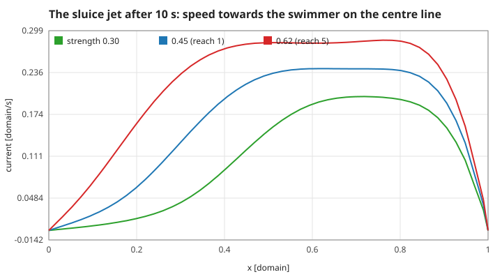
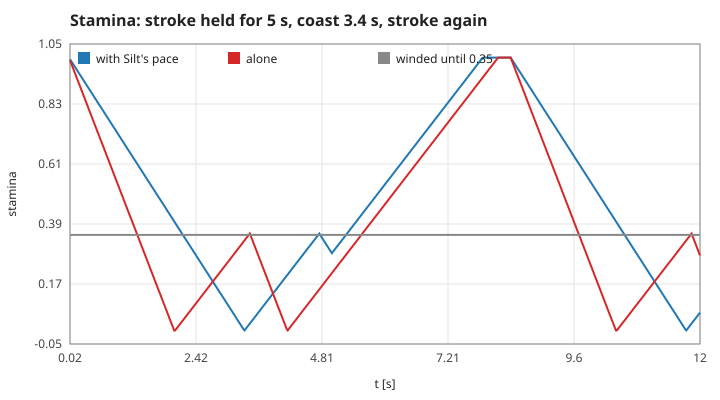
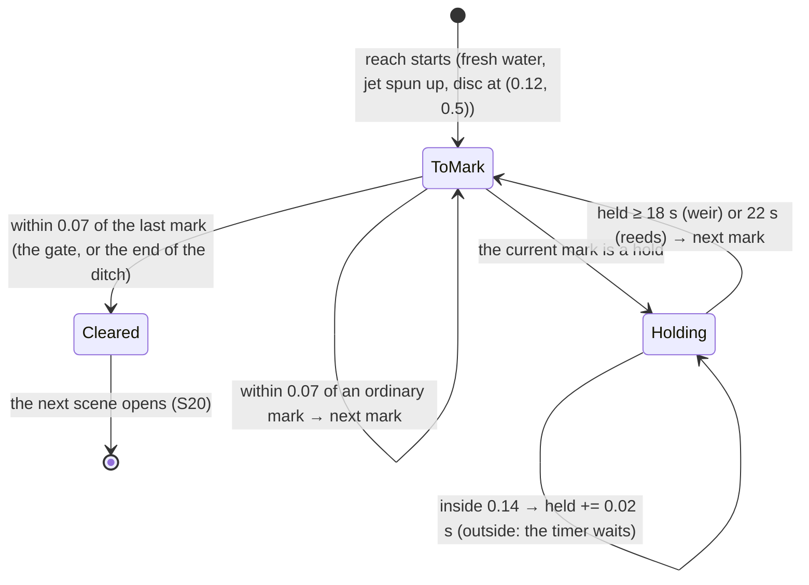
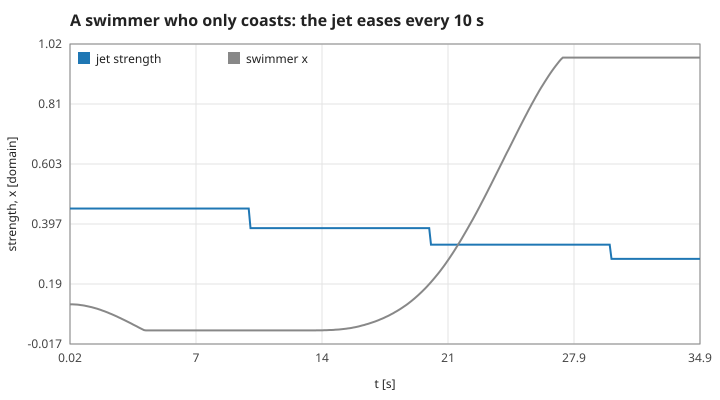
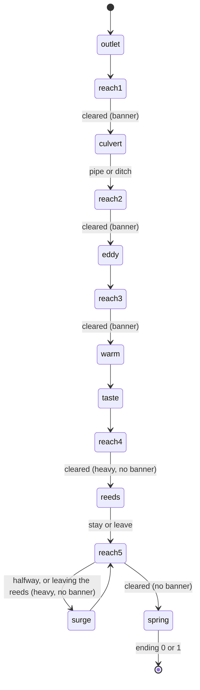

# 4. Upstream: the rules of the game layer

`src/journey.c` puts a game on the unchanged water and disc: a sluice jet blows from the right wall, and the swimmer has to reach a gate at $x = 0.82$ five times ("reaches"). These are rules, not laws of nature; each is stated with its constants so the code can be checked against it. Measured numbers are quoted by their id in [figures/values.md](figures/values.md).

[Back to the index](README.md)

## S16 — The sluice jet and its spin-up

**Statement.** In every step of a reach a force blob (S05) of strength $g$ pointing in $-x$, width 0.07, centred at $(0.96, 0.5)$, drives a jet against the swimmer. Each reach starts from fresh water in which that jet has already run for 500 steps (10 s). The strength before story effects is, reach by reach, 0.45, 0.60, 0.30, 0.55, 0.62.

**Assumptions and where they break.** The blob sits 0.04 from the wall, so over a quarter of its footprint is clipped; $g$ is a strength, not a total force. The jet is not proportional to $g$: a stronger jet entrains and recirculates more. The developed field depends only on $g$, so it is computed once per strength and copied.

**Derivation.** A design rule. In a closed box the water blown left must return along the top and bottom, so the pond holds two large eddies; the swimmer meets the strongest current on the centre line near the gate and slack or favourable water near the side walls.

**Code.** `sluice`, `spin_up` and `start_reach` in `src/journey.c` (static); `BASE_FLOW`, `SLUICE_X`, `SLUICE_RADIUS`, `SPIN_UP_STEPS`.

**Tests.** `[mech] route` in `tests/test_story.c` asserts the jet's strength on both routes. Measured: `jet-flow-reach1` = 0.45; the game's own water at the start line equals a stand-alone spin-up bit for bit (`jet-game-start`); the fastest water on the centre line is `jet-peak-0.45` = 0.24 and `jet-peak-0.62` = 0.28 domain/s, against the disc's 0.415 through the water; doubling the strength from 0.30 to 0.62 raises the peak only 1.42 times (`jet-linear`).

## S17 — Stamina: a budget for strokes

**Statement.** Stamina $s \in [0, s_{max}]$, $s_{max} = 1$ unless changed by the story:

$$\dot s = \begin{cases} -0.50 \times (\text{story factors}) & \text{while the tail beats} \\ +0.25 \times (\text{story factors}) & \text{while coasting} \end{cases}$$

At $s = 0$ the swimmer is **winded**: strokes do nothing until $s \ge 0.35\,s_{max}$. Time below $0.2\,s_{max}$ is counted as strain; below $0.12\,s_{max}$ marks a crisis in the bench.

**Assumptions and where they break.** A stroke that is asked for while winded costs nothing and recovers like a coast. The hysteresis (empty at 0, back at 0.35) is what makes over-spending costly: 1.4 s of drifting in the current.

**Derivation.** Design rules. Alone, a full budget lasts 1/0.50 = 2 s of strokes; with Silt setting the pace (×0.60) 3.3 s; a winded swimmer waits 0.35/0.25 = 1.4 s.

**Code.** `drain_rate`, `regen_rate` and the first lines of `journey_step` in `src/journey.c`; `DRAIN`, `REGEN`, the `winded` flag.

**Tests.** `[mech] pace`, `[mech] eddy`, `[mech] warm` in `tests/test_story.c`. Measured: winded after `stamina-empty-pace` = 3.34 s with the pace and `stamina-empty-alone` = 2.02 s without; strokes work again `stamina-back` = 1.42 s later.

## S18 — Marks, the gate, and holds

**Statement.** A reach is a list of 1 to 3 marks, taken in order. A mark is reached when the disc's centre is within 0.07 of it; reaching the last mark clears the reach. The last mark is the gate at $(0.82, 0.5)$, except on the ditch route, which ends at $(0.78, 0.80)$. Two marks are **holds**: the swimmer must stay within 0.14 of them for a time that only runs while it is inside the ring, with the clock and the current running throughout:

| hold | where | time |
|---|---|---|
| the weir (ditch route, reach 2) | second of three marks, $(0.55, 0.86)$ | 18 s |
| beside Silt in the reeds (staying, reach 5) | first of two marks, $(0.16, 0.5)$ | 22 s |

**Assumptions and where they break.** Reaching is judged once per step on the centre, so a fast disc can pass a small mark between steps only if it moves more than 0.14 in 0.02 s — it cannot. While a hold is active, ground lost is not counted as a sweep (S19).

**Derivation.** Design rules: a hold is "waiting" made of swimming — the story never skips time.

**Code.** `set_marks`, `journey_hold_need`, `journey_hold_radius` and the end of `journey_step` in `src/journey.c`; `MARK_RADIUS`, `GATE_X`, `HOLD_RADIUS`, `WEIR_HOLD`, `STAY_HOLD`.

**Tests.** `[mech] route` (the 18 s hold at the weir, all of it swimming time) and `[mech] parting` (the 22 s beside Silt) in `tests/test_story.c`. Measured: a step taken 0.028 from the gate clears the reach and opens the next scene (`gate-clears`, `gate-scene`); the ditch has `ditch-marks` = 3; `weir-hold-need` = 18, `hold-radius` = 0.14, and held on the mark the next one opens after `weir-hold-time` = 18.00 s.

## S19 — Swept back, and the jet that eases

**Statement.** The game remembers the furthest $x$ reached in the reach. If the disc is found more than 0.20 behind it, that is a **sweep**: a counted failure, a banner, and the jet's strength is multiplied by 0.85. Independently, every 10 s spent in a reach without clearing it multiplies the strength by 0.85 as well.

**Assumptions and where they break.** There is no way to lose a reach: every failure makes the next attempt easier, so the journey always ends (the bench stops a run after 1200 s and has never needed to). The easing changes the forcing, not the water: the jet already in the pond takes a few seconds to slacken.

**Derivation.** Design rules. After $k$ easings the strength is $0.85^k g$: three bring the last reach's 0.62 down to 0.38.

**Code.** `journey_step` in `src/journey.c`: `SWEEP_LOSS`, `EASE_FLOW`, `EASE_SECONDS`, `best_x`, `sweeps`, `sweeps_reach`, `crisis_reach`.

**Tests.** `[choice]` and the tension rows of the bench count sweeps as failures (`tests/test_story.c`, `docs/narrative/tension.json`). Measured: the first easing comes at `ease-time` = 10.00 s and three of them leave `ease-factor` = 0.614 = 0.85³; a disc found 0.26 behind its best counts `sweep-count` = 1, multiplies the strength by `sweep-ease` = 0.85 and raises the swept banner; coasting alone never loses 0.20 of ground (`ease-no-sweep` = 0) — the return flow carries the disc to `coast-drift-x` = 0.97.

## S20 — Scenes, choices and the numbers they change

**Statement.** Eight scenes open at fixed points of progress; nothing swims while one is open. Each numeric effect is one bit of `effects`, so the bench can remove them one at a time.

| scene | opens | options | effect (bit) |
|---|---|---|---|
| outlet | at the start | 1 | `JE_PACE`: strokes cost ×0.60 while Silt swims along |
| culvert | reach 1 cleared | 2 | `JE_ROUTE`: pipe = jet ×1.30; ditch = jet ×0.60, strokes ×0.40, three marks with the 18 s weir |
| eddy | reach 2 cleared | 1 | `JE_EDDY`: stamina refilled to a reserve of 1.50 for reaches 3 and 4 |
| warm, then taste | reach 3 cleared | 1, 1 | `JE_WARM`: recovery ×0.12 in reach 4 |
| reeds (heavy) | reach 4 cleared | 2 | `JE_PARTING`: Silt's pace ends. Stay (`JE_STAY`): stamina refilled, recovery ×1.40, the 22 s hold; leave: nothing |
| surge (heavy) | reach 5: at $x \ge 0.5$, or on leaving the reeds after staying | 1 | `JE_SURGE`: jet ×1.30 after staying, ×1.22 after leaving at once |
| spring | reach 5 cleared | 1 | the ending: 0 = stayed, 1 = left |

Heavy scenes and the ending are shown with no "cleared" banner before or after.

**Assumptions and where they break.** The order is fixed by progress, not by time or chance. With a bit off its scene still opens but changes nothing.

**Derivation.** Design rules; what each effect and each choice does to the two measured outcomes (journey time, time in strain) is in `docs/narrative/ablation.json`, written by `make story`.

**Code.** `journey_init`, `journey_free`, `journey_step`, `journey_answer`, `journey_options`, `journey_heavy`, `journey_ending` and the static helpers `open_scene`, `clear_reach`, `raise_banner` in `src/journey.c`; the bits `JE_PACE` … `JE_SURGE` in `src/journey.h`.

**Tests.** `tests/test_story.c`: `[order]` (every seed meets the scenes in this order and both endings are reached), `[mech] pace`, `[mech] route`, `[mech] eddy`, `[mech] warm`, `[mech] parting`, `[quiet] reeds`, `[quiet] surge`, `[choice]`. Measured: `scenes-shown` = 8, `scene-first` = 0, `heavy-scenes` = 2, `choice-scenes` = 2, `ending-stay` = 0, `ending-leave` = 1, `ending-before` = −1; the bench's pilot took `journey-time-stay` = 100.0 s and `journey-time-leave` = 100.6 s on one seed (the distributions are in the bench files).

## References

- The rules are this repository's: `src/journey.c`, `docs/design.md`. The water and the disc they act on are pages 1–3.
