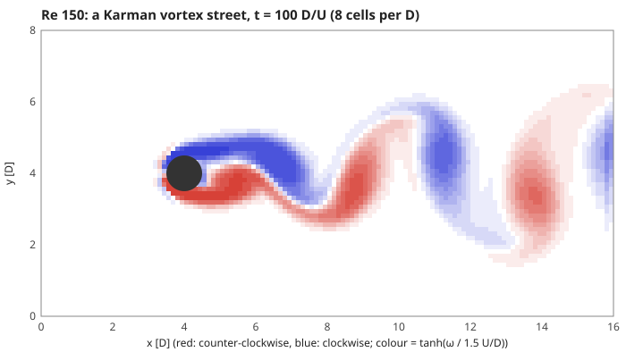
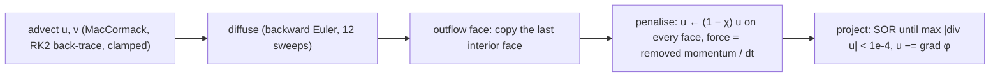
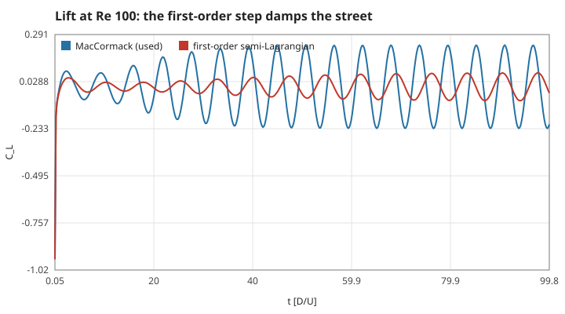
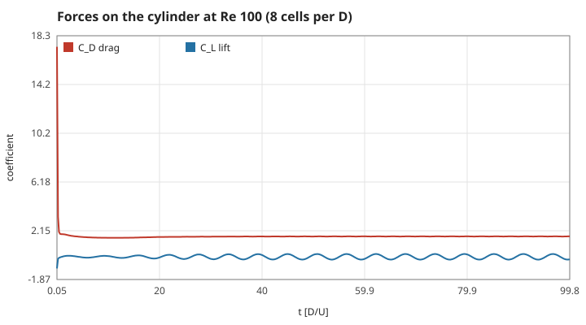
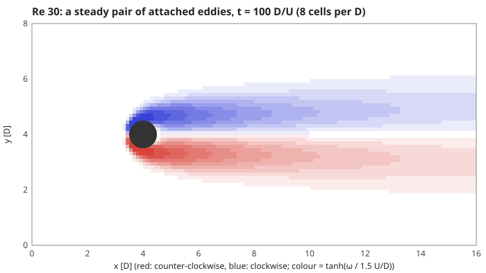
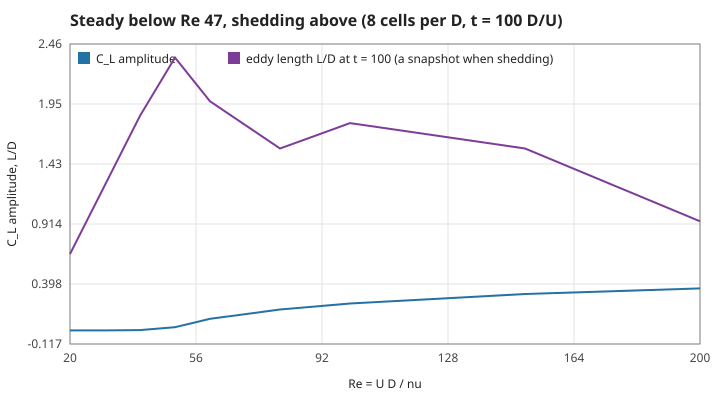
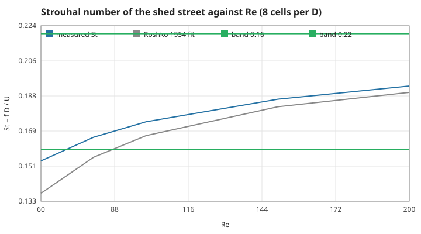
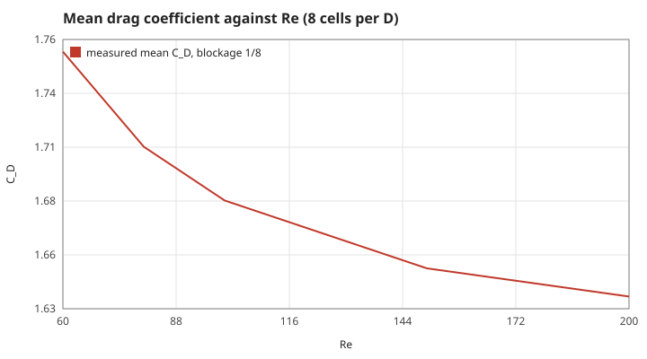
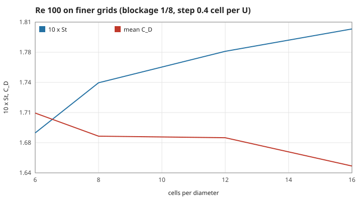
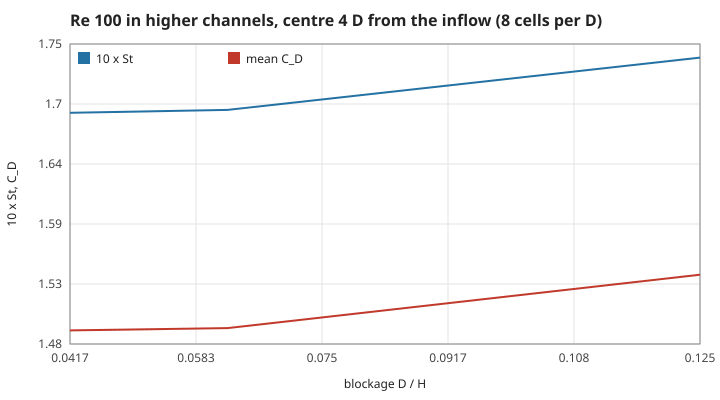

# 5. Behind a post: the Kármán vortex street (M2)

Water flowing past a fixed circular cylinder, the classic problem the pool of pages 1–4 cannot show (there the disc is not an obstacle, S13). This page is a separate solver, `src/wake.c`; the pool, the swimmer and Upstream are unchanged. Units: the cylinder diameter $D = 1$, the inflow speed $U = 1$, density 1, so times are in $D/U$ and forces in $\rho U^2 D$ per unit span. Measured numbers are quoted by their id in [figures/values.md](figures/values.md); the literature values are quoted from the papers named, not re-derived here.

[Back to the index](README.md)

## S21 — The problem and its one number: Re = UD/ν in a channel

**Statement.** Steady inflow $U$ past a cylinder of diameter $D$ in a fluid of kinematic viscosity $\nu$ depends, after scaling lengths by $D$ and times by $D/U$, on the single number

$$\mathrm{Re} = \frac{UD}{\nu}.$$

The code solves the incompressible Navier–Stokes equations (S01) in a channel 16 D long and 8 D high with the cylinder centre at $(4D, 4D)$: inflow $u = U, v = 0$ at the left, zero-gradient outflow with the pressure fixed to 0 at the right, free-slip walls at the top and bottom (no flow through, no shear), and $\nu = 1/\mathrm{Re}$.

**Assumptions and where they break.** Two dimensions: a real wake turns three-dimensional above Re ≈ 190 [Williamson 1996], so Re 200 is the edge of what a 2D model describes. The walls block $D/H = 1/8$ of the channel, which speeds up the flow past the cylinder; S26 measures what that changes. The outflow condition reflects a little of each passing vortex; the cylinder is 12 D upstream of it.

**Derivation.** With $\mathbf x' = \mathbf x/D$, $t' = tU/D$, $\mathbf u' = \mathbf u/U$, $p' = p/(\rho U^2)$, the momentum equation becomes $\partial_{t'}\mathbf u' + (\mathbf u'\cdot\nabla')\mathbf u' = -\nabla' p' + \mathrm{Re}^{-1}\nabla'^2\mathbf u'$: only Re is left. Choosing $D = U = 1$ makes $\nu = 1/\mathrm{Re}$.

**Code.** `wake_init` (the default channel) and `wake_init_channel` (any height, used for the blockage study) in `src/wake.c`; the boundary values are set by `bc_u` and `bc_v`.

**Tests.** `test_projection_and_mass` in `tests/test_wake.c`: outflow equals inflow to 0.1 %. Measured at Re 100: `wake-mass` = $7\times10^{-5}$.

## S22 — The channel step: staggered grid, exact projection, second-order advection

**Statement.** Each step is the Stable Fluids split of S01 — advect, diffuse, project — with three changes that matter for a wake: velocities live on the faces of the cells (a MAC grid), so the discrete divergence of a discrete gradient is exactly the five-point Laplacian and the pressure solve can make every cell divergence-free; that solve is iterated (successive over-relaxation, $\omega = 1.85$, warm-started from the last step) until $\max|\nabla\cdot\mathbf u| < 1\times10^{-4}\,U/D$; and advection is MacCormack's [Selle et al. 2008] with a midpoint back-trace: one semi-Lagrangian step back, one forward from its result, half the round-trip error added back, then clamped to the four old values around the departure point.

**Assumptions and where they break.** The clamp keeps the maximum principle of S07 but drops back to first order near sharp extrema. Diffusion is backward Euler with 12 Gauss–Seidel sweeps; at these Re the matrix is close to the identity ($\nu\Delta t/h^2 \le 0.09$). The time step is fixed at 0.4 cell per $U$ (`wake_dt`); near the cylinder the flow is up to about 1.6 $U$, so particles cross up to two thirds of a cell per step.

**Derivation.** Linear interpolation at a point a fraction $c$ of a cell from the grid point spreads a profile with variance $h^2c(1-c)$ per step. With $\Delta t = ch/u$ that is a numerical viscosity $\nu_{num} = h^2c(1-c)/(2\Delta t) = \tfrac12 uh(1-c)$ for the first-order step of S07: at 8 cells per diameter, $c = 0.4$ and $u = U$ it is $0.0375\,UD$, several times the physical $\nu = 0.01$ at Re 100 (the bound for uniform flow; the wake is slower in places). MacCormack cancels the leading error term, so its numerical viscosity is of higher order in $h$. The measured first-order Strouhal number below, 0.140, is what Roshko's fit (S25) gives at Re ≈ 62: the first-order wake behaves like one at a Reynolds number below 100.

**Code.** `wake_step` calls `advect`, `diffuse`, `penalize` and `project` (static) in `src/wake.c`; `trace` is the midpoint back-trace and `interp` the clamped bilinear sample. `first_order` in the `Wake` struct switches back to the plain semi-Lagrangian step for comparison. `wake_max_divergence` and `wake_sample` read the result.

**Tests.** `test_projection_and_mass`: after 200 steps the largest cell divergence is below $1\times10^{-4}$. Measured at Re 100: `wake-div` = $4.6\times10^{-5}$ after the last step, `wake-sweeps` = 66 sweeps per step on average. The first-order step gives a lift swing of `wake-first-order-cl` = 0.33 of the MacCormack one and a Strouhal number of `wake-first-order-st` = 0.140 instead of 0.174: numerical viscosity lowers the effective Re.

## S23 — The cylinder as a penalised obstacle, and the force on it

**Statement.** The cylinder is a solid fraction $\chi\in[0,1]$ on every velocity face: 1 farther than half a cell inside the radius, 0 farther than half a cell outside, linear between. Each step removes the solid part of the velocity, $\mathbf u \leftarrow (1-\chi)\mathbf u$ — the limit $\eta\to 0$ of the Brinkman penalisation term $-\chi\mathbf u/\eta$ [Angot, Bruneau & Fabrie 1999]. The momentum removed per unit time is the force of the water on the cylinder,

$$\mathbf F = \frac{h^2}{\Delta t}\sum_{\text{faces}}\chi\,\mathbf u,\qquad C_D = \frac{2F_x}{\rho U^2 D},\qquad C_L = \frac{2F_y}{\rho U^2 D}.$$

**Assumptions and where they break.** The wall is spread over one cell, so the body the water sees is slightly larger and rounder than a staircase but not a sharp circle; the force on a coarse grid carries that error (S26). Penalising before the projection leaves a small velocity inside the solid after the step; it is removed again at the next step, and that removed momentum includes the pressure push, so the step-by-step force is noisy and only its average over whole periods is used.

**Derivation.** Newton's third law on the control volume of the solid: whatever momentum the penalisation takes out of the water per unit time, the cylinder receives. Averaged over a lift period the transient terms of the momentum balance cancel.

**Code.** `penalize` (static), `solid` (the fraction) and `wake_drag_coefficient`, `wake_lift_coefficient` in `src/wake.c`.

**Tests.** `test_projection_and_mass`: inside the cylinder the water is at rest ($|u|, |v| < 0.05\,U$). `test_shedding` and `test_steady_twin_vortex` check the drag (S25, S24). Measured at Re 100: `wake-cd-100` = 1.68, the drag swing is `wake-cd-amp-100` = 0.026 of the lift swing.

## S24 — Two regimes: twin eddies below Re ≈ 47, shedding above

**Statement.** Below a critical Reynolds number of about 47 [Provansal, Mathis & Boyer 1987] the flow behind the cylinder is steady: two attached eddies of opposite sign, mirror-symmetric about the centre line, whose length grows with Re (Dennis & Chang 1970: $L/D$ = 0.94 at Re 20, 2.35 at Re 40, measured from the rear point). Above it the symmetric wake is unstable (a Hopf bifurcation) and the eddies leave alternately, so the lift oscillates.

**Assumptions and where they break.** Near the threshold the instability grows slowly; at Re 50 a run of 100 D/U is still growing. The closed-wake length is read where $u$ on the centre line turns positive again; while shedding it is only a snapshot.

**Derivation.** The steady symmetric solution exists for all Re; its stability changes at the critical Re, beyond which a small asymmetry grows exponentially until it saturates as a limit cycle (the Stuart–Landau model of Provansal et al.). The nudge at the start (a weak cross-flow blob, `wake_init`) seeds that asymmetry.

**Code.** `wake_recirculation_length` and `wake_vorticity_at` in `src/wake.c`; `render_wake_svg` in `src/render.c` draws the field (also `./current-swimmer --karman`).

**Tests.** `test_steady_twin_vortex` at Re 30 (6 cells per D): lift amplitude below 0.01, a closed eddy between 0.8 D and 2.2 D long, $C_D$ within 1.6–2.6. Measured on 8 cells per D: `wake-clamp-30` = $6\times10^{-5}$, `wake-clamp-40` = 0.0022, `wake-clamp-60` = 0.10. Eddy lengths `wake-lr-20` = 0.66 and `wake-lr-40` = 1.84 are 30 % and 22 % shorter than Dennis & Chang's, and the drag `wake-cd-20` = 2.42, `wake-cd-40` = 1.91 is 18–26 % higher — the same direction as the drag excess of S26.

## S25 — The Strouhal number: how often the street swings

**Statement.** The shedding frequency $f$ scales as

$$\mathrm{St} = \frac{fD}{U},$$

which for a circular cylinder rises slowly with Re in the laminar range. Roshko (1954) fitted $\mathrm{St} = 0.212\,(1 - 21.2/\mathrm{Re})$ for Re between 50 and 150; the accepted band for Re 100–200 is about 0.16–0.20 [Williamson 1996], and the check of this repository allows 0.16–0.22. The time-averaged drag of an unbounded cylinder is about 1.33 there (two-dimensional simulations, e.g. Park, Kwon & Choi 1998).

**Assumptions and where they break.** $f$ is measured from upward zero crossings of $C_L - \overline{C_L}$, linearly interpolated, over the second half of the run (the start-up is not periodic); at least 3 crossings and a swing of at least 0.01 are required, otherwise no frequency is reported. The fit is taken past its range at Re 200 only as a guide.

**Derivation.** Each lift period sheds one vortex from each side; $C_L$ crosses its mean upwards once per period, so $f = (\text{crossings} - 1)/(t_{last} - t_{first})$. Drag is averaged over the same whole periods so that a partial period does not bias it.

**Code.** `wake_stats` and `strouhal_number` in `src/wake.c`; `wake_run` runs a whole case.

**Tests.** `test_stats_on_a_sine` checks the counter on a known signal (frequency to $1\times10^{-4}$). `test_shedding` (6 cells per D, 60 D/U): at Re 100, 150 and 200 the lift swings by more than 0.1 over at least 4 periods, St lies in 0.16–0.22 and rises with Re, and the mean $C_D$ lies in 1.3–1.9 — the lower bound is the unbounded value (walls and a thick wall do not lower drag), the upper bound leaves room for the 24–28 % excess measured on that grid (S26). Measured on 8 cells per D: `wake-st-100` = 0.174, `wake-st-150` = 0.186, `wake-st-200` = 0.193, within 4.3 %, 2.2 % and 1.8 % of Roshko's fit; drag `wake-cd-150` = 1.65, `wake-cd-200` = 1.63.

## S26 — How far to trust the numbers: grid, time step, blockage

**Statement.** A converged answer should not change when the grid or the time step is refined or the channel widened. At Re 100 the Strouhal number moves by less than 4 % from 8 to 16 cells per diameter and by 1.7 % when the time step is halved; the drag stays 24–28 % above the unbounded literature value on every grid tried, and falls only slowly (2 % from 8 to 16 cells per D).

**Assumptions and where they break.** Each case is one run of 100 D/U from the same start. The study fixes Re 100; the shedding cases of S25 use 8 cells per D, the unit tests 6. The excess drag is not explained by blockage (widening the channel from 8 D to 24 D lowers it by 3.5 %) nor by the time step (−3.6 %); the remaining candidates are the one-cell penalised wall, which makes the body the water sees a little larger, and the splitting of penalisation from projection. Neither has been isolated here.

**Derivation.** Finer grids lower the numerical viscosity of S22, so the effective Re rises and the street sheds faster: St rises from `wake-st-n6` = 0.169 through 0.174 to `wake-st-n12` = 0.178 and `wake-st-n16` = 0.180, and the lift swing approaches its literature value (`wake-clamp-n16` = 0.34 against about 0.33). Blockage speeds the flow past the cylinder and raises St: in channels 16 D and 24 D high St falls back to `wake-st-h16` = 0.169 and `wake-st-h24` = 0.169, within 1.2 % of Roshko's fit.

**Code.** `wake_init_channel` (channel height) and `wake_dt` (step) in `src/wake.c`; the studies are run by `fig_wake` in `tests/theory_figs.c` (sixteen runs, in parallel processes).

**Tests.** Measurements only: drag `wake-cd-n6` = 1.71, `wake-cd-n12` = 1.68, `wake-cd-n16` = 1.65; half step `wake-st-dt2` = 1.017 and `wake-cd-dt2` = 0.964 of the full-step values; blockage `wake-cd-h16` = 1.63, `wake-cd-h24` = 1.62. The CI check (`test_shedding`) uses the coarsest grid, whose St (0.169) is the lowest of the four, so passing it on 6 cells per D does not depend on the refinement.

## References

- A. Roshko, *On the development of turbulent wakes from vortex streets*, NACA Report 1191 (1954).
- S. C. R. Dennis and G.-Z. Chang, *Numerical solutions for steady flow past a circular cylinder at Reynolds numbers up to 100*, J. Fluid Mech. 42 (1970).
- M. Provansal, C. Mathis and L. Boyer, *Bénard–von Kármán instability: transient and forced regimes*, J. Fluid Mech. 182 (1987).
- C. H. K. Williamson, *Vortex dynamics in the cylinder wake*, Annu. Rev. Fluid Mech. 28 (1996).
- J. Park, K. Kwon and H. Choi, *Numerical solutions of flow past a circular cylinder at Reynolds numbers up to 160*, KSME Int. J. 12 (1998).
- P. Angot, C.-H. Bruneau and P. Fabrie, *A penalization method to take into account obstacles in incompressible viscous flows*, Numer. Math. 81 (1999).
- A. Selle, R. Fedkiw, B. Kim, Y. Liu and J. Rossignac, *An unconditionally stable MacCormack method*, J. Sci. Comput. 35 (2008).
