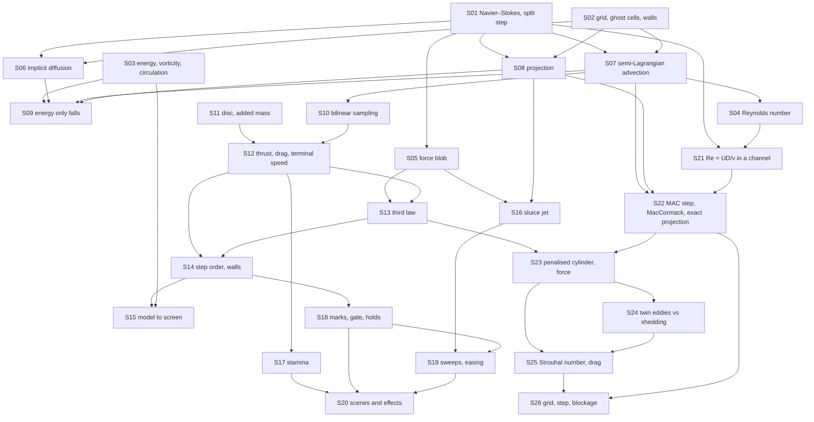

# Theory handbook

Why the program is correct — and where it is deliberately only approximate — from the repository alone: every law, numerical rule and game rule the code relies on, each stated in Markdown **with a figure**, the place in the code that implements it, and the test or measurement that checks it.

- Units: the pond is the unit square (lengths in domain widths), time in seconds, density 1.
- Plotted figures and the numbers quoted in the text are produced by the program's own functions: `make theory-figs` rewrites [figures/](figures/) and [figures/values.md](figures/values.md). Diagrams are Mermaid, written in the pages.
- `make theory-check` fails when a statement has no figure, a link is broken, a referenced function or test no longer exists, or a public function is missing from the tables below.

## Pages

1. [The water: equations, grid, walls and what is measured](01-navier-stokes.md) — incompressible Navier–Stokes and the split step, the grid and free-slip walls, energy / vorticity / circulation, the Reynolds number
2. [The Stable Fluids step, piece by piece](02-stable-fluids.md) — the force blob, implicit diffusion, semi-Lagrangian advection and its numerical diffusion, the pressure projection, energy decay, sampling
3. [The swimmer: a disc in the water, and the path to the screen](03-swimmer.md) — added mass, thrust and drag, Newton's third law, the step and the walls, model to screen
4. [Upstream: the rules of the game layer](04-upstream.md) — the sluice jet, stamina, marks and holds, sweeps and easing, scenes
5. [Behind a post: the Kármán vortex street (M2)](05-wake.md) — Re = UD/ν in a channel, the staggered-grid step with MacCormack advection and an exact projection, the penalised cylinder and its force, steady twin eddies against shedding, the Strouhal number and drag, grid / time-step / blockage studies

## How the pieces depend on each other

## Coverage: statement → page → figure → code → test

| ID | Statement | Page | Figure | Code | Test |
|---|---|---|---|---|---|
| S01 | Incompressible Navier–Stokes; the split step | [1](01-navier-stokes.md) | mermaid | `src/fluid.c#fluid_step`, `src/fluid.c#fluid_init`, `src/fluid.c#fluid_free` | `tests/test_fluid.c#test_still_water_stays_still`, `tests/test_fluid.c#test_symmetry_of_mirrored_forcing` |
| S02 | Grid, ghost cells, free-slip walls | [1](01-navier-stokes.md) | `figures/walls.svg` | `src/fluid.c#set_bnd` | `tests/theory_figs.c#wall-normal` |
| S03 | Energy, vorticity, circulation, divergence | [1](01-navier-stokes.md) | `figures/vorticity.svg` | `src/fluid.c#fluid_kinetic_energy`, `src/fluid.c#fluid_vorticity_at`, `src/fluid.c#fluid_max_abs_vorticity`, `src/fluid.c#fluid_total_circulation`, `src/fluid.c#fluid_max_divergence` | `tests/theory_figs.c#circulation-cell` |
| S04 | Reynolds number $UL/\nu$ | [1](01-navier-stokes.md) | `figures/reynolds.svg` | `src/fluid.c#reynolds_number` | `tests/test_fluid.c#test_reynolds_number` |
| S05 | Force as a Gaussian blob | [2](02-stable-fluids.md) | `figures/force.svg` | `src/fluid.c#fluid_add_force`, `src/swimmer.c#push_fluid` | `tests/theory_figs.c#force-impulse` |
| S06 | Implicit diffusion, stable for any step | [2](02-stable-fluids.md) | `figures/diffusion.svg` | `src/fluid.c#diffuse`, `src/fluid.c#lin_solve` | `tests/theory_figs.c#diffusion-decay` |
| S07 | Semi-Lagrangian advection; numerical diffusion | [2](02-stable-fluids.md) | `figures/advection.svg`, mermaid | `src/fluid.c#advect` | `tests/test_fluid.c#test_unforced_flow_only_loses_energy`, `tests/theory_figs.c#advection-nu-48` |
| S08 | Pressure projection, 24 Gauss–Seidel sweeps | [2](02-stable-fluids.md) | `figures/projection.svg` | `src/fluid.c#project` | `tests/test_fluid.c#test_projection_keeps_flow_divergence_free` |
| S09 | Unforced energy only falls | [2](02-stable-fluids.md) | `figures/energy.svg` | `src/fluid.c#fluid_kinetic_energy` | `tests/test_fluid.c#test_unforced_flow_only_loses_energy` |
| S10 | Bilinear sampling | [2](02-stable-fluids.md) | `figures/sample.svg` | `src/fluid.c#fluid_sample` | `tests/theory_figs.c#sample-linear` |
| S11 | The disc and its added mass | [3](03-swimmer.md) | `figures/swimmer-speed.svg` | `src/swimmer.c#swimmer_init`, `src/swimmer.c#swimmer_speed` | `tests/theory_figs.c#first-step-speed` |
| S12 | Thrust, drag, terminal speed | [3](03-swimmer.md) | `figures/drag.svg` | `src/swimmer.c#swimmer_step` | `tests/test_fluid.c#test_stroke_pushes_swimmer_forward_and_water_backward` |
| S13 | Newton's third law: reactions into the water | [3](03-swimmer.md) | mermaid | `src/swimmer.c#push_fluid` | `tests/theory_figs.c#third-law` |
| S14 | Heading, step order, pool walls | [3](03-swimmer.md) | mermaid | `src/swimmer.c#swimmer_step` | `tests/test_fluid.c#test_swimmer_stays_inside_the_pool` |
| S15 | From the model to the screen | [3](03-swimmer.md) | mermaid | `src/view.c#view_init`, `src/view.c#view_step`, `src/view.c#view_state`, `src/view.c#view_field`, `src/render.c#render_rows`, `src/render.c#render_frame`, `src/render.c#render_field_svg` | `tests/test_view.c#view_init`, `tests/test_fluid.c#test_render_draws_every_cell` |
| S16 | The sluice jet and its spin-up | [4](04-upstream.md) | `figures/jet.svg` | `src/journey.c#spin_up`, `src/journey.c#start_reach` | `tests/test_story.c#[mech] route` |
| S17 | Stamina and being winded | [4](04-upstream.md) | `figures/stamina.svg` | `src/journey.c#drain_rate`, `src/journey.c#regen_rate`, `src/journey.c#journey_step` | `tests/test_story.c#[mech] pace` |
| S18 | Marks, the gate, holds | [4](04-upstream.md) | mermaid | `src/journey.c#set_marks`, `src/journey.c#journey_hold_need`, `src/journey.c#journey_hold_radius` | `tests/test_story.c#[mech] route` |
| S19 | Sweeps and the easing jet | [4](04-upstream.md) | `figures/easing.svg` | `src/journey.c#SWEEP_LOSS`, `src/journey.c#EASE_FLOW` | `tests/theory_figs.c#sweep-count` |
| S20 | Scenes, choices, effects, endings | [4](04-upstream.md) | mermaid | `src/journey.c#journey_init`, `src/journey.c#journey_free`, `src/journey.c#journey_answer`, `src/journey.c#journey_options`, `src/journey.c#journey_heavy`, `src/journey.c#journey_ending` | `tests/test_story.c#[order]`, `tests/test_story.c#[quiet] reeds` |
| S21 | Re = UD/ν; the channel and its boundaries | [5](05-wake.md) | `figures/wake-street.svg` | `src/wake.c#wake_init`, `src/wake.c#wake_init_channel`, `src/wake.c#wake_free`, `src/wake.c#bc_u`, `src/wake.c#bc_v` | `tests/test_wake.c#test_projection_and_mass`, `tests/theory_figs.c#wake-mass` |
| S22 | Staggered grid, MacCormack advection, exact projection | [5](05-wake.md) | `figures/wake-advection.svg`, mermaid | `src/wake.c#wake_step`, `src/wake.c#wake_dt`, `src/wake.c#advect`, `src/wake.c#project`, `src/wake.c#wake_max_divergence`, `src/wake.c#wake_sample` | `tests/test_wake.c#test_projection_and_mass`, `tests/theory_figs.c#wake-div`, `tests/theory_figs.c#wake-first-order-st` |
| S23 | The penalised cylinder; force and pressure impulse | [5](05-wake.md) | `figures/wake-forces.svg` | `src/wake.c#penalize`, `src/wake.c#wake_drag_coefficient`, `src/wake.c#wake_lift_coefficient`, `src/wake.c#wake_control_volume_drag` | `tests/test_wake.c#test_shedding`, `tests/theory_figs.c#wake-cd-100` |
| S24 | Steady twin eddies below Re ≈ 47, shedding above | [5](05-wake.md) | `figures/wake-steady.svg`, `figures/wake-regimes.svg` | `src/wake.c#wake_recirculation_length`, `src/wake.c#wake_vorticity_at`, `src/render.c#render_wake_svg` | `tests/test_wake.c#test_steady_twin_vortex`, `tests/theory_figs.c#wake-clamp-40` |
| S25 | Strouhal number St = fD/U; mean drag | [5](05-wake.md) | `figures/wake-strouhal.svg`, `figures/wake-drag.svg` | `src/wake.c#wake_stats`, `src/wake.c#strouhal_number`, `src/wake.c#wake_run` | `tests/test_wake.c#test_stats_on_a_sine`, `tests/test_wake.c#test_shedding`, `tests/theory_figs.c#wake-st-150` |
| S26 | Grid, time step and blockage studies | [5](05-wake.md) | `figures/wake-convergence.svg`, `figures/wake-blockage.svg`, `figures/wake-domain.svg` | `src/wake.c#wake_init_channel`, `src/wake.c#wake_init_setup`, `src/wake.c#wake_dt` | `tests/test_wake.c#test_sharp_wall`, `tests/theory_figs.c#wake-st-n16`, `tests/theory_figs.c#wake-st-dt2`, `tests/theory_figs.c#wake-st-h24` |

Tests named `tests/theory_figs.c#…` are measurements recorded in [figures/values.md](figures/values.md) by `make theory-figs`, not assertions of `make test`. S02, S03, S05, S06, S10, S11, S13 and S19 are covered only that way; turning them into assertions is a follow-up.

What the measurements made visible (none of it is changed here):

- **Numerical viscosity.** On the game's 48 × 48 grid the advection step alone damps a flow of speed 0.3 like a viscosity of 0.0018, 4.4 times the 0.0004 that is set (S07). The Reynolds number on screen is computed from the set value (S04).
- **The pressure solve is a fixed budget.** After a step, the leftover divergence is about 5 % of the largest vorticity on the game's grid; on a 96 × 96 grid the same 24 sweeps leave 43 % (S08). A net push on the water takes about a second to drain into the walls instead of vanishing at once.
- **The walls are free-slip** (S02), so no vorticity is shed from them.
- **The disc is not an obstacle** (S13): the water feels its reaction forces, not its shape. Page 5 (M2) adds a separate solver in which a fixed cylinder is.
- **The cylinder's drag depends on the projection and domain** (S26). At Re 100 the revised default-channel value is 1.543; the larger domain gives 1.345. The literature drag values are provisional until checked against the originals.

## Public functions that state no law

| Function | What it is |
|---|---|
| `src/svg.c#svg_plot` | writes the line charts of this handbook and of `make plots` |
| `src/gif.c#gif_open`, `src/gif.c#gif_frame`, `src/gif.c#gif_close`, `src/gif.c#gif_text_size`, `src/gif.c#gif_draw_text` | GIF89a/LZW encoder for the demo animation |

## Reading the source against this table

Functions reviewed for this handbook: every declaration in `src/fluid.h`, `src/swimmer.h`, `src/journey.h`, `src/view.h`, `src/render.h`, `src/svg.h`, `src/gif.h` and `src/wake.h`; the static helpers `bc_u`, `bc_v`, `interp`, `trace`, `advect`, `diffuse`, `penalize`, `project`, `solid` in `src/wake.c`; the `wv_*` wrappers of `src/wake_web.c`, which only forward to the `wake_*` functions; the static helpers `set_bnd`, `lin_solve`, `diffuse`, `advect`, `project` in `src/fluid.c`, `push_fluid` in `src/swimmer.c`, and `on`, `at_weir`, `in_reeds`, `open_scene`, `raise_banner`, `set_marks`, `drain_rate`, `regen_rate`, `sluice`, `spin_up`, `start_reach`, `clear_reach` in `src/journey.c`; `scripted` and `run_headless` in `src/main.c`; the wrappers of `src/journey_web.c`, which only forward to the `journey_*` functions. The bench's pilot (`tests/story_policy.h`) is test code, not a rule of the game.

The simulation and the game are unchanged by this handbook: it adds `tests/theory_figs.c`, `scripts/theory-check.py`, two Makefile targets and these pages. Page 5 documents the wake solver added in M2; `make theory-figs` runs its sixteen studies in parallel processes (about 6 minutes on a loaded 28-core machine, most of it the 16-cells-per-D run).
